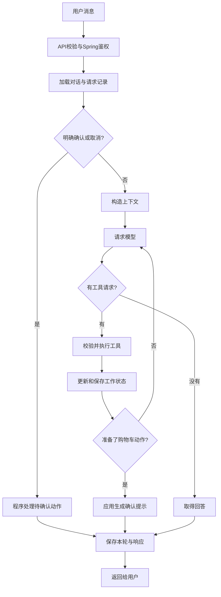

# 从零理解 OnlineOrder Agent V2：从一句点单请求到真实购物车

这份教程写给第一次接触 Agent 开发、能看懂基本函数和 JSON、但不熟悉 Agent 架构的读者。你不需要先学过 LangChain、LangGraph、RAG 或 Redis 分布式锁。

这里解释的是 `feat/agent-harness-v2` 分支、业务代码提交 `b726519` 的实际实现。教程新增在它之后；本文不会把计划中的功能当成已经写好的功能。

阅读时始终围绕四个问题：**现在要解决什么问题，谁负责解决，它读写什么数据，为什么把它放在这一层。** 文件名只是最后帮助你找到代码，不是理解的起点。

## 怎么阅读

第一次建议按正文顺序读。每一层都会用前一层已经解释过的概念，不需要同时打开所有源码。

|阅读层次|内容|读完应该能解释什么|
|---|---|---|
|[第一层：整体思路](#part-1)|第1—4节|模型、Agent程序和Spring分别做什么；为什么需要这几层|
|[第二层：一次请求怎样完成](#part-2)|第5—9节|Tool Calling到底传了什么；循环为什么需要多次模型请求|
|[第三层：多轮对话怎样接起来](#part-3)|第10—13节|Session存什么；“第二个”和“最好有avocado”如何被处理|
|[第四层：记忆怎样使用](#part-4)|第14—17节|短期与长期的区别；怎样抽取、检索、使用和删除偏好|
|[第五层：购物车为什么这样设计](#part-5)|第18—22节|准备和提交的区别；确认、重复请求、超时和并发如何处理|
|[第六层：回到源码](#part-6)|第23—25节|启动装配、完整调用链和模型切换分别在哪；如何按顺序读代码|
|[第七层：怎样判断做得对不对](#part-7)|第26—28节|错误、测试、完成率、召回和延迟分别衡量什么|
|[第八层：亲手验证](#part-8)|第29—31节|不用Key跑通，做有预期结果的实验，并检查自己是否理解|

所有示例菜单均来自仓库的合成演示数据，不是你的线上商品。文中用 `S`、`R`、`A` 指代某个Session、请求、动作时，它们是讲解用代号；真实API需要使用程序返回的UUID。

<a id="part-1"></a>
## 1. 先不考虑大模型：你的点餐系统本来怎样工作

假设用户在普通网页上点餐。他先选择筛选条件，网页向后端发请求；后端查数据库，返回商品；用户点击添加，网页再向购物车接口发请求。

例如：

```text
用户勾选：鸡肉、15美元以内
    ↓
网页发送 POST /api/search
    ↓
Spring查询商品和库存
    ↓
网页显示两张商品卡片
    ↓
用户点“添加两份”
    ↓
网页发送 POST /api/cart/items
    ↓
Spring修改购物车并返回新的购物车
```

这套系统已经知道什么商品存在、价格是多少、当前用户是谁、购物车里有几份。**增加Agent以后，这些事实的管理者仍然是原来的后端。**

增加的需求只是：用户不想手动填所有表单，而是说：

> 帮我找15美元以内、不太辣的鸡肉。

然后又说：

> 最好有avocado。第二个不错，把它加两份。

自然语言里有几个普通表单没有的问题：

- “不太辣”要转成后端接受的数值。
- “最好有avocado”没有重新说预算，但预算不能自动丢掉。
- “第二个”没有商品ID，必须对应到刚才展示的列表。
- “不错”可能只是喜欢，不等于授权修改购物车。
- 后端没有响应时，程序得判断是否可以再次发送。

V2的各个模块，都是为了处理这些具体问题。先记住这些问题，再看模块，会更容易理解为什么需要它们。

## 2. 大模型能帮什么，不能替谁完成什么

把一次模型请求理解成一个函数：

```text
给它：本次输入 + 已知背景 + 可用工具说明
得到：一段回答，或者一个/多个工具调用请求
```

模型擅长把“鸡肉、不太辣、15美元以内”理解成：

```json
{
  "primary_protein": "CHICKEN",
  "max_spicy_level": 1,
  "max_price": 15
}
```

但它输出这段JSON时，并没有自动查询你的数据库。它说“已经加进购物车”，也不意味着你的Spring事务真的执行了。

在本项目里，调用模型的HTTP请求本身没有携带数据库连接、Spring登录JWT（登录后取得的身份Token）或一个可以随意执行的Python函数。模型只是向调用它的程序返回数据。

因此我们需要一段普通程序来检查它的请求，再决定要不要调用Spring。这段普通程序就是接下来经常出现的 **Harness**：你可以先把这个词理解为“围绕模型的运行控制程序”。

### 2.1 为什么模型不会因为sessionId就自动记住你

当前模型适配器每次都调用 `chat.completions.create`，自己构造 `messages`。它没有把 `sessionId` 当成模型平台上的永久记忆编号，也没有依赖平台自动保存上一段聊天。

如果第二次请求只把“最好有avocado”交给模型，模型就没有可靠依据知道上一次的预算和蛋白质条件。程序必须主动读取历史和状态，再把需要的信息放进这次请求。

所以“多轮记忆”首先是应用如何保存和重新提供信息的问题，不是给模型起一个Session名字就完成了。

### 2.2 这一版的分工

|问题|负责者|原因|
|---|---|---|
|用户大概想找什么、这句是否在细化搜索|模型|自然语言表达很多，很难全靠固定规则覆盖|
|工具是否存在、参数是不是整数、引用是否真实|Agent程序|这些规则明确，应该由可重复验证的程序执行|
|这条消息属于哪个用户和对话|Agent程序与Spring鉴权|身份不能由模型猜，也不能由用户在消息中指定|
|商品价格、当前购物车、餐厅是否营业|Spring|它管理真实业务数据和业务规则|
|是否已经确认某一项待执行动作|Agent程序|副作用的授权边界需要稳定、可检查|
|一句解释性回复是否友好|主要由模型|这类表达适合语言生成，但仍需测试真实性|

模型理解和程序规则互相配合。模型并不是所有规则的最终裁判。

## 3. 先看一条贯穿全文的对话

为方便理解，演示菜单里有两个相关商品：

|显示位置|商品|单价|真实菜单ID尾号|
|---|---|---|---|
|1|Avocado Chicken Bowl|12美元|`...0001`|
|2|Avocado Chicken Wrap|14美元|`...0002`|

完整ID在程序中保存；这里暂时只看尾号。

|用户这一轮说什么|这一轮解决的问题|关键结果|
|---|---|---|
|找15美元以内不太辣的鸡肉|把自然语言变成筛选，并查实际商品|保存有效筛选和两个候选商品|
|最好有avocado|在原来的条件上补充食材|预算、鸡肉、辣度保留，再加keyword|
|第二个不错|把位置2变成真实商品引用|只保存selected_item，不改购物车|
|把第二个加入两份|确定要添加哪个商品和多少份|产生待确认动作，购物车仍未修改|
|确认|确认上一项具体动作|程序单次提交添加，购物车变成两份|
|查看购物车|取得当前真实购物车|再次读Spring，不依据旧回答猜测|

同样是六句聊天，背后包含三种不同工作：**理解语言、管理对话状态、修改业务数据**。把它们混成一个“模型回答”就很难判断哪里出错。

## 4. 什么是Agent、编排、执行循环

在这份代码中，Agent可以理解为：

```text
模型：提出下一步建议
上下文：让模型知道这次任务相关的信息
工具：允许应用完成的具体动作
控制程序：验证建议、执行动作、保存状态、决定是否继续
```

**编排（orchestration）**就是控制程序安排这些步骤的先后关系。例如先鉴权，再加载Session；普通消息交给模型；明确确认走程序分支；工具结果成功后更新状态。

**执行循环（loop）**是编排中的一部分：调用一次模型，执行它请求的工具，把结果送回模型，再调用模型。它可能重复，直到得到最终回答或碰到停止边界。

这两个词不要混淆：编排还包括鉴权、确认、保存、恢复等循环外的工作。



这个图里，“确认”不是模型循环继续想一想。它由外层程序直接识别并处理。这一处安排决定了模型不能通过连续调用工具来自己完成用户确认。

<a id="part-2"></a>
## 5. Tool到底是什么：从一个普通Python函数讲起

普通程序可以写一个函数来查询商品：输入筛选条件，输出商品列表。Tool Calling增加的是：允许模型用约定的数据格式请求这个能力。

它需要三个部分，缺一不可：

|部分|它是什么|本项目位置|
|---|---|---|
|工具说明|告诉模型名字、用途和参数格式|[definitions.py](../app/tools/definitions.py)|
|应用执行逻辑|收到名字和参数后进行校验、合并与调用|[executor.py](../app/tools/executor.py)|
|后端访问代码|真正向某个Spring端点发送HTTP请求|[onlineorder_backend.py](../app/clients/onlineorder_backend.py)|

工具说明不是函数实现。它只相当于给模型看一份“你可以申请哪些服务”的说明。

### 5.1 为什么不让模型直接输出任意URL

假设允许模型输出 `url`、`method`、`body`，然后应用照单发送。模型就有机会请求原本不该开放的管理、支付或未知端点，也很容易猜错真实接口。

本项目只允许六个固定工具，程序自己决定这些工具分别调用哪个后端路径。模型不知道某个路径，就不能凭空增加能力。

```text
search_menu             查全局商品
list_restaurants        查餐厅
get_menu                看已知餐厅的菜单
select_search_result    记录选中的候选
get_cart                查看当前用户购物车
add_to_cart             准备添加，等待后续确认
```

最后一个名字容易误导，先记住：当前实现中，`add_to_cart`本身只准备，不发送真正添加请求。第18节会解释它与提交函数的区别。

### 5.2 参数格式是什么，为什么要限制

`quantity`必须是整数，`position`必须在允许范围，模型不能额外提供 `user_id`、`price` 或 `confirmed=true`。

如果只在提示词里说“请传整数”，模型仍可能输出字符串 `"2"`。因此需要实际校验。项目用的 **Pydantic** 是Python数据校验库：它按照类里声明的字段检查JSON，不符合就拒绝。

例如 `AddToCartArgs` 的实际核心定义是：

```python
class AddToCartArgs(EmptyArgs):
    position: int | None = Field(default=None, ge=1, le=100)
    quantity: int = Field(ge=1, le=99)
```

`ge`表示大于等于，`le`表示小于等于；`int | None`表示可以是整数，也可以没有位置。没有位置时，只能使用之前明确选中的商品。

它继承的配置有 `strict=True`、`extra="forbid"`：尽量不做模糊类型转换，也不接受声明之外的字段。`"2"`、`true`、`1.5`都不能作为合法数量。

这里的99是V2对单次操作施加的限制，不是声称Spring DTO本身限制到99。

## 6. 第一次搜索：模型到底收到什么、返回什么

用户发来的聊天请求可以是：

```json
{
  "message": "找15美元以内不太辣的鸡肉",
  "requestId": "8cadca59-d254-4684-8290-d2a9871fd7c2"
}
```

这是发给Agent的请求，不是发给模型的完整内容。API鉴权后，Agent还会决定哪些背景和工具说明应该送给模型。

这里把某个时刻读取的数据副本称为“快照”：它能证明那次读到了什么，不能保证以后一直不变。

第一次普通搜索没有历史Session状态时，模型主要看到：系统指令、本轮用户消息、六个工具的说明，以及可能检索到的长期偏好。

系统指令会解释：具体食物查询应该使用search_menu；“不太辣”通常对应1；不要重复生成卡片字段；不能自行确认加购。它在 [prompt.py](../app/agent/prompt.py) 中。

### 6.1 一次搜索可能对应的工具参数

下面是一份完整的搜索参数示例，与工具声明中的字段对应。未指定的条件用null；这不是要求用户把所有条件填写一遍。

```json
{
  "keyword": null,
  "cuisine_type": null,
  "category": null,
  "primary_protein": "CHICKEN",
  "max_spicy_level": 1,
  "max_sweetness_level": null,
  "vegetarian": null,
  "caffeinated": null,
  "serving_temperature": null,
  "min_price": null,
  "max_price": 15,
  "limit": 10,
  "start_new_search": false,
  "clear_filters": []
}
```

模型平台返回的工具请求包含名字、参数和一个调用编号。适配器把它变成 [base.py](../app/llm/base.py) 中的 `ToolCall`：

```text
call_id   = 这一次工具请求的编号
name      = search_menu
arguments = 上面那份JSON的字符串形式
```

注意arguments是字符串。收到后必须解析和校验，不能因为外层模型响应是JSON，就假设内层参数一定正确。

### 6.2 这时还没有查询Spring

到这里仅仅发生了一次模型网络请求。真正查询必须继续经过：

```text
AgentOrchestrator._run_tool_loop
    → ToolExecutor.execute("search_menu", arguments, context)
    → SearchMenuArgs校验
    → 合并筛选并校验合并后的状态
    → OnlineOrderBackendClient.search_menu
    → POST /api/search
```

工具请求里没有真实用户JWT。执行器的 `ToolContext` 是程序另外构造的对象，里面才带有本次请求已验证的授权信息、已有筛选和候选列表。这样模型提出业务参数，应用补充可信的执行环境。

## 7. 为什么Executor和Backend Client要分成两层

先看search_menu分别要处理的两类工作。

**对话相关工作**：判断这次是细化还是重新搜索；把新的keyword合到旧预算上；把真实结果转换成可引用的position。这些事情属于Agent，Spring并不知道“上一轮”是什么。

**HTTP相关工作**：路径是 `/api/search`；字段要从 `max_price` 变成 `maxPrice`；设置Authorization；检查HTTP状态；解析响应。这些事情属于后端访问边界，不应该散落在所有对话分支里。

所以Executor管理前一类工作，Backend Client管理后一类工作。增加新工具时，你可以分别检查“对话规则是否正确”和“接口是否真的存在”，不会把两者混在一个长函数中。

### 7.1 实际发给Spring的请求更短

第6节的工具参数会被转换为：

```json
{
  "primaryProtein": "CHICKEN",
  "maxSpicyLevel": 1,
  "maxPrice": 15,
  "limit": 10
}
```

没有值的字段被移除。`start_new_search`、`clear_filters`属于Agent自己的会话规则，不在Spring搜索DTO里，因此不会发送。

### 7.2 响应为什么还要再校验

HTTP 200只表示服务器给了一个成功状态，并不证明body符合代码期望。代理可能给HTML，服务可能返回一个对象而非数组，字段也可能丢失。

当前Client会先检查JSON和容器形状，再检查搜索结果具有字符串类型的 `menuItemId`、`menuItemName`。购物车则用更完整的 `CartSnapshot` 校验数量、金额和items。

这不是对所有后端字段都做了完整契约证明：搜索结果的很多可选元数据仍由转换器宽容解析。准备写操作时还会校验实际引用的UUID。要区分这些校验的覆盖范围，不能把“做了校验”理解成“所有坏数据都不可能通过”。

## 8. 工具执行结果为什么有两种用途

[ToolExecutionResult](../app/tools/executor.py)同时携带两类内容：

```text
output          要交回模型的JSON字符串
search_state    要由应用保存的有效筛选
search_results  要由应用保存的真实候选
selected_item   如果这次确实选中了商品
pending_action  如果这次准备了添加动作
cart            如果这次取得了购物车
restaurants     如果这次取得了餐厅列表
```

它们不一定同时有值。例如搜索成功会提供output、search_state、search_results；参数错误只提供带error的output。

**为什么不让模型读完output以后，再告诉程序要保存什么？** 因为真实菜单ID和有效筛选已经由程序得到，再经过一次模型生成会增加弄错字段、编造商品或丢失条件的机会。

所以执行循环直接检查这些结构字段并更新Session。这是“应用管理状态”的具体含义：状态更新依据的是可信执行结果，而不是从助手的自然语言回答里提取。

搜索结果还会通过 `_to_cards` 转成前端卡片。卡片的名字、ID和价格来自后端结果，不让模型重新拼一份商品JSON。这样回答文字与展示数据至少在来源上有明确区分。

## 9. 为什么执行一次工具之后，还经常要再请求一次模型

第一次模型只知道要去查菜单，不知道查出来什么。后端返回后，应用把工具结果送回模型，它才能解释“找到了符合条件的商品”或“没有符合条件的商品”。

下面按平台消息顺序看，省略的是工具定义等外层配置，不是隐藏了一次业务执行：

```text
第一次请求模型：
  system：你的任务和规则
  user：找15美元以内不太辣的鸡肉

第一次模型返回：
  assistant：申请调用search_menu，调用ID=c1，参数=鸡肉/辣度1/预算15

应用执行：
  调Spring → 得到两件商品

第二次请求模型：
  原来的system和user
  assistant：刚才那份tool_calls（ID=c1）
  tool：ID=c1，结果=ok、有效筛选、两件实际商品

第二次模型返回：
  assistant：简短的说明性回答
```

`role=tool`表示“这是工具结果”，不是又来了一句用户指令。`call_id`把某份结果和某次请求对应起来，防止多工具结果被混淆。

项目内部先用 `function_call_output` 表示结果；[ChatCompletionsModel._messages](../app/llm/chat_completions.py) 再把它转成平台接受的role=tool格式，并保留相同ID。

**一次用户消息、一次模型请求、一次工具调用不是同一个计量单位。** 一句用户搜索通常需要两次主循环模型请求和一次工具调用。若还要提取长期记忆，可能额外再请求模型；用户确认加购的程序分支则可以完全不请求模型。

本轮input_items是临时的模型输入列表；里面会追加assistant的tool_calls和tool结果，但这份完整工具对话没有全部保存到Session.messages。跨用户轮次主要靠近期user/assistant文本与结构state接续，因此Session JSON不是一份全量工具审计日志。

### 9.1 循环什么时候结束

- 模型没有请求工具，且返回非空文本：普通结束。
- 工具准备了pending_action：程序直接生成确认提示并结束本轮。
- 工具次数、时间、上下文或重复调用越界：受控停止。
- 模型或服务出错：依据错误类别返回降级结果或HTTP错误。

默认一轮最多尝试5个工具。这个数字不是最多5轮用户聊天，也不是最多5次模型请求。

同一轮内，工具名和规范化参数完全相同的调用会被拦住。规范化是为了把 `{"position":2}` 和多几个空格的同一JSON视为同一个请求。这个集合每个用户轮次重新建立，所以下一轮再次查购物车仍然允许。

这个防循环措施与后面actionId的防重复写入是两回事：前者限制模型在一轮里打转，后者控制已经确认的业务动作是否再次派发。

<a id="part-3"></a>
## 10. Session是什么：应用为一段对话保存的记录

先把Session理解成“这一段点单对话的记录文件”。它有一个编号sessionId，里面保存最近说过的话、当前筛选、候选商品、选择和待确认动作。

HTTP请求彼此独立。第二次请求不会天然带着第一次请求的Python局部变量，因此客户端要带回sessionId，服务才能查出属于同一段对话的记录。

当前数据类型是 [ConversationSession](../app/models/session.py)。把常用字段先翻译成人话：

|字段|你可以怎样理解|为什么有它|
|---|---|---|
|session_id|这段对话的编号|把前后独立HTTP请求接起来|
|user_id|这段对话属于哪个已登录用户|防止知道编号的人读取别人的对话|
|messages|最近用户和助手说过的话|理解语言上下文和刚才交流过的内容|
|state|应用保存的当前任务事实和引用|避免只靠聊天原文猜当前有效条件|
|summary|更旧用户原话的有界摘录|节省上下文，留下部分旧线索|
|turn_count|已经正常收尾了多少轮用户交互|观察会话进度|
|revision|完成一轮时增加的版本计数|辅助观察更新，不是数据库锁|
|created_at / updated_at|建立和完成更新的时间|排查记录生命周期|
|schema_version|这份记录的数据格式版本|为以后改变结构保留标识|

`owner_fingerprint`是旧会话迁移留下的兼容字段。新会话使用稳定user_id，不再把每次变化的Token当作用户身份。你第一次读可以先不研究旧记录升级分支。

### 10.1 messages和state为什么同时存在

假设messages中有：

```text
用户：找15美元以内的鸡肉。
助手：找到了。
用户：加点avocado。
助手：已经细化。
用户：第二个不错。
```

只保存这些话，会留下很多需要重新解释的问题：现在预算还在不在？第二个到底是哪一个ID？最后一次查的列表是什么？

state保存的是已经处理过的明确结构。下面是讲解用的**状态摘录**，不是完整Session：

```json
{
  "search": {
    "primary_protein": "CHICKEN",
    "max_spicy_level": 1,
    "max_price": 15,
    "keyword": "avocado",
    "limit": 10
  },
  "last_search_results": [
    {
      "position": 1,
      "menu_item_id": "a4000000-0000-0000-0000-000000000001",
      "name": "Avocado Chicken Bowl"
    },
    {
      "position": 2,
      "menu_item_id": "a4000000-0000-0000-0000-000000000002",
      "name": "Avocado Chicken Wrap"
    }
  ],
  "selected_item": {
    "menu_item_id": "a4000000-0000-0000-0000-000000000002",
    "name": "Avocado Chicken Wrap"
  }
}
```

messages帮助理解交流，state支持可验证操作。它们解决的问题不同，因此不互相替代。

### 10.2 第一轮后真正存下的完整Session

下面从仓库已运行生成的样例文件取第一轮记录，完整展示；没有用省略号隐藏字段。你暂时不必记住每个商品元数据字段，先定位messages、search、last_search_results和pending_action。

```json
{
  "schema_version": 2,
  "session_id": "d6b76614-60ec-476b-ba0f-0d29880655a2",
  "revision": 1,
  "turn_count": 1,
  "user_id": "11111111-1111-1111-1111-111111111111",
  "owner_fingerprint": null,
  "messages": [
    {
      "role": "user",
      "content": "找15美元以内不太辣的鸡肉"
    },
    {
      "role": "assistant",
      "content": "已查询到工具返回的数据。"
    }
  ],
  "state": {
    "current_task": "MENU_SEARCH",
    "search": {
      "keyword": null,
      "cuisine_type": null,
      "category": null,
      "primary_protein": "CHICKEN",
      "max_spicy_level": 1,
      "max_sweetness_level": null,
      "vegetarian": null,
      "caffeinated": null,
      "serving_temperature": null,
      "min_price": null,
      "max_price": 15.0,
      "limit": 10
    },
    "last_search_results": [
      {
        "position": 1,
        "menu_item_id": "a4000000-0000-0000-0000-000000000001",
        "name": "Avocado Chicken Bowl",
        "description": "Synthetic offline fixture",
        "ingredient_summary": "chicken avocado rice",
        "restaurant_name": "Fixture Kitchen",
        "restaurant_id": "a3000000-0000-0000-0000-000000000001",
        "price": 12.0,
        "image_url": null,
        "category": "MAIN",
        "cuisine_type": "AMERICAN",
        "available_quantity": 10,
        "primary_protein": "CHICKEN",
        "spicy_level": 1,
        "sweetness_level": 0,
        "vegetarian": false,
        "caffeinated": false,
        "serving_temperature": "HOT"
      },
      {
        "position": 2,
        "menu_item_id": "a4000000-0000-0000-0000-000000000002",
        "name": "Avocado Chicken Wrap",
        "description": "Synthetic offline fixture",
        "ingredient_summary": "chicken avocado tortilla",
        "restaurant_name": "Fixture Kitchen",
        "restaurant_id": "a3000000-0000-0000-0000-000000000001",
        "price": 14.0,
        "image_url": null,
        "category": "MAIN",
        "cuisine_type": "AMERICAN",
        "available_quantity": 5,
        "primary_protein": "CHICKEN",
        "spicy_level": 0,
        "sweetness_level": 0,
        "vegetarian": false,
        "caffeinated": false,
        "serving_temperature": "HOT"
      }
    ],
    "selected_item": null,
    "phase": "CHAT",
    "pending_action": null,
    "cart": null,
    "last_restaurants": [],
    "results_updated_at": "2026-11-04T17:48:43.288072Z"
  },
  "summary": null,
  "created_at": "2026-11-04T17:48:43.285284Z",
  "updated_at": "2026-11-04T17:48:43.288214Z"
}
```

现在对照读：

- messages只有一对user/assistant，说明只完成一轮用户交互。
- search中未指定的字段是null，limit有缺省值10。null表示没有这个筛选值，不等于“用户要求取消旧值”；清除操作第11节单独讲。
- last_search_results保存真实菜单UUID、位置和展示数据。它是这一轮查询时得到的快照。
- selected_item=null：展示了商品，不代表用户已选择。
- pending_action=null、phase=CHAT：没有等待确认的添加。
- cart=null：这个Session还没有通过工具取得购物车快照；不表示真实购物车一定为空。
- results_updated_at告诉程序候选是什么时候取得的；它和整个Session的更新时间作用不同。

这里多个null的含义并不完全相同，要结合字段职责理解。特别是“还没查到cart”与“查到空cart”不是同一个状态。

### 10.3 state里的几个标记分别干什么

`current_task`记录最近主要处理的是搜索、菜单浏览还是cart；空状态是NONE。代码会据此决定是否把工作状态放进模型上下文，它不是一个自动拆任务、执行计划的规划器。

`phase`表示当前工作流是否正在等确认，常见值是CHAT和AWAITING_CONFIRMATION；真正待确认的商品、数量、期限存在pending_action对象里。光有一句“正在等确认”，没有这份参数记录，仍然不知道该执行什么。

Schema还保留CHECKOUT_PROCESSING和DONE，但本版没有实现进入这些结账阶段的Agent流程。枚举里有一个名字，不等于这个功能已经完成。

`last_restaurants`保存查询过的餐厅引用，用于后续菜单工具核对餐厅ID。它与last_search_results的商品引用各自服务不同工具。

## 11. “最好有avocado”怎么保留上一轮条件

这一节是多轮对话最重要的一段。用户并不会每一句都重述预算，程序也不应该让模型每次凭记忆重新抄一份全部条件。

处理第二轮前，`_build_context`会把当前有效search放入模型上下文。提示词要求普通细化只提供新变化，并保持 `start_new_search=false`。

模型这次表达的变化重点是：

```json
{
  "keyword": "avocado",
  "start_new_search": false,
  "clear_filters": []
}
```

这是对变化字段的展示；完整工具schema还包含其他可空字段。应用校验器也能处理这种只含变化的输入。

执行器的 `_merge_search_filters` 做了一个程序化合并，而不是只相信这次JSON中的内容：

```text
旧条件：鸡肉 + 辣度≤1 + 价格≤15 + limit=10
新变化：keyword=avocado
    ↓
最终条件：鸡肉 + 辣度≤1 + 价格≤15 + keyword=avocado + limit=10
```

其实际规则是：

1. start_new_search=true时，从缺省SearchFilters开始；否则复制旧条件。
2. 先把clear_filters点名的字段清掉。
3. 对这次明确提供且不为null的字段，写入新值。
4. 用SearchFilters重新校验整份合并结果。
5. 移除与primary_protein重复的关键词，再调用Spring。

第3步会用 `model_fields_set` 区分“这次确实提供了limit”与“Pydantic给了一个缺省limit”。否则旧limit=3可能在普通细化时被不小心恢复成10。

### 11.1 为什么不能只校验新变化

旧条件min_price=10，新变化max_price=5。单独看5是一个合法非负价格，但合并后“至少10、最多5”是矛盾的。

所以校验必须覆盖合并后的状态。失败时不覆盖原search和候选，防止一次坏参数破坏上一轮可用结果。

### 11.2 清掉预算和重新开始不是同一件事

“这次不限预算，其他保持”：

```json
{
  "clear_filters": ["max_price"],
  "start_new_search": false
}
```

“重新找素食，先别管刚才的条件”：

```json
{
  "vegetarian": true,
  "start_new_search": true,
  "clear_filters": []
}
```

上面仍是突出变化的输入示例。第一种只清一个条件，第二种从新搜索出发。

传 `"max_price": null`本身不会清掉旧预算。因为模型经常把未指定字段填null，如果将null都当作“撤销”，原条件就会全部丢失。

### 11.3 为什么去掉keyword中重复的chicken

真实后端的keyword是一个连续子串查询，并不是把多个单词自动拆开作语义检索。把“avocado chicken”整个字符串放进去，可能搜不到名字为“Chicken Avocado Bowl”的商品。

已经有primary_protein=CHICKEN时，再从keyword里移掉重复chicken，只保留avocado，能让结构化条件和子串条件各自发挥作用。

这并不意味着系统实现了通用分词或中英语义搜索。中文食材转英文仍主要依赖模型；后端检索能力没有被悄悄改变。

## 12. “第二个不错”为什么要调用选择工具

候选映射已经是：位置1→菜单ID0001，位置2→菜单ID0002。模型看到用户表达选择，可以提出：

```json
{"position": 2}
```

执行器不会让模型自行填写选中商品的名称和价格，而是去Session已有的候选中找position=2。找到后，用那条真实记录构造SelectedItem。

这一步只更新selected_item，不调用购物车接口。因此：

```text
展示商品 ≠ 用户选择
用户选择 ≠ 要求加购
准备加购 ≠ 已经提交
```

这些区别不是为了多设计几个状态，而是因为它们对应不同程度的用户意图和不同的业务后果。

如果用户只问“第二个是什么”，提示词要求直接解释已知结果，不必调用选择工具。如果模型仍错误选择了，这是意图理解层的问题；程序不能仅靠合法position判断用户的原意。测试和真实评测需要覆盖这类误选。

### 12.1 为什么新搜索会清掉旧选择和旧确认

假设旧列表第二个是鸡肉卷，新列表第二个是豆腐沙拉。如果旧selected_item或pending_action继续保留，用户说“确认”时就可能加到与当前页面不一致的商品。

所以搜索/浏览成功产生新候选时，控制程序会替换last_search_results、更新时间，并清空选择和待确认动作。选了另一个候选也会撤销旧待确认动作。

位置是“最后一份候选列表里的编号”，不是永久商品身份。真实菜单ID才是提交时使用的身份。

### 12.2 看某家餐厅菜单为什么走另一条路径

全局搜索和浏览餐厅菜单不是一个HTTP接口。用户想浏览时，模型可以先申请list_restaurants：程序调用 `GET /api/restaurants`，把公开的餐厅id、name等信息保存为last_restaurants。

接下来get_menu带着某个真实restaurant_id，执行器先确认这个ID来自已保存餐厅或搜索结果，再调用 `GET /api/restaurants/{restaurantId}/menu`。不会让模型猜一个路径就去查询。

两类响应的字段不同：搜索叫menuItemId/menuItemName，菜单叫id/name。执行器把菜单字段映射成共同的SearchResultReference，因此用户之后仍可以用“第二个”选择，不必知道它最初来自哪个端点。

菜单中可能出现缺货项，并有sellable、availableQuantity等状态；全局搜索则按后端规则只返回当时可购买的候选。Agent不把“在菜单中展示”理解成“现在一定能买到”。成功浏览菜单也会替换候选、撤销旧选择和旧待确认动作。

浏览菜单不会给search偷偷加一个restaurant_id筛选；当前搜索DTO没有这个字段。get_menu成功主要替换候选，已有search筛选仍保留，后续search是否重新开始由对应参数决定。不能把“刚浏览了一家店”理解成全局搜索已经自动锁定这家店；要增强这种对话语义，需要另行设计状态与工具规则。

## 13. Session放哪里，为什么不能无限增长

开发模式用 [InMemorySessionStore](../app/memory/in_memory.py)：把序列化JSON放在当前Python进程的字典里。它容易跑和测试，但进程重启后数据丢失，另一个worker也看不到这份字典。

Redis模式用 [RedisSessionStore](../app/memory/redis_store.py)：把同样一份JSON存到外部Redis服务。Redis在这里首先是共享键值存储，不是模型，也不是向量库。

典型键是：

```text
agent:session:<sessionId> → 一份ConversationSession JSON
```

默认Session TTL=14400秒，也就是4小时。**TTL**表示记录的有效期；不是让程序暂停4小时。保存Session时会重新设置有效期，单纯分页读取通常不会延长它。

### 13.1 如果过期了，为什么返回404而不是偷偷重建

用户沿用旧sessionId说“把第二个加入两份”。如果应用偷偷新建Session，原来的候选和条件已经不存在，却表现得像还在继续同一对话，会很危险。

当前实现只有没传sessionId才创建新会话；明确传了但找不到则返回SESSION_NOT_FOUND，要求重新开始并建立真实引用。

### 13.2 保存一份JSON就自动解决并发了吗

没有。整体SET避免保存半份JSON，但两个进程仍可能都读到旧版本，各自修改，再互相覆盖。后面第22节的用户锁解决正常并发路径中的这个问题。

revision只是记录完成更新的计数，代码没有根据revision执行“只在版本没变化时才写入”的比较交换操作。因此不能把它误读成已经实现了数据库乐观锁。

<a id="part-4"></a>
## 14. 短期记忆：这次任务中必须带着走的信息

短期记忆不是一个独立、神秘的AI组件。V2中它主要由三部分构成：

1. messages：最近说过的话。
2. state：已经整理好的筛选、候选和待确认动作。
3. summary：更早用户原话的有限摘录。

如果每次都把全部对话发给模型，输入会越来越长。模型请求按token计量，token可以粗略理解为模型处理文字的单位；它不是固定等于一个字，也不总等于一个单词。长上下文会增加费用和延迟，也可能淹没当前重点。

因此 [compact_session](../app/memory/compaction.py) 默认只保留12条消息，即6对user/assistant。它保留成对消息，避免只留下助手回答却丢掉对应问题。

### 14.1 summary在这版里实际上是什么

假设为了观察设置recent_message_limit=4，已有三轮交流：

```text
用户1 / 助手1
用户2 / 助手2
用户3 / 助手3
```

保留最近两轮后，messages是用户2/助手2、用户3/助手3。用户1的原话可以进入summary。

实际规则是：被移除的消息里只收集用户原话；每条最多180字符；最多保留最后6条。summary是把这些引用序列化后的JSON字符串。例如：

```json
["今天想吃鸡肉", "先看看不太辣的"]
```

把JSON再存进Session的字符串字段后，会出现转义引号，这是正常的序列化形式。

这里没有额外调用模型生成长篇摘要。为什么这样选？因为让模型把旧对话“总结成事实”可能把助手猜测也固化下来，且增加费用。保存用户原话更容易知道来源，但信息覆盖有限：更老内容最终还是会丢。

预算、候选ID、pending_action因此必须放在结构state中，而不能指望summary永远保留。这个设计用结构化保存承担关键状态，让文本摘录只补充交流线索。

## 15. 长期记忆：跨Session保留的稳定偏好

用户今天说“找15美元鸡肉”，通常只是本次需求；用户说“我平时一直吃得比较清淡，记住我偏好微辣”，才可能适合未来继续使用。

长期记忆用于后一类稳定偏好。它不是一份永久聊天记录，也不保存“第二个商品”“本次购物车两份”等会随任务变化的信息。

|信息|应放在哪里|原因|
|---|---|---|
|本轮预算15美元|state.search|未必代表永久预算|
|上次展示的第二个商品|state.last_search_results / selected_item|依赖当前结果列表|
|待确认加两份|state.pending_action|必须带期限和具体动作ID|
|通常偏好微辣|Spring长期memory|后续Session可能仍相关|
|当前cart数量|Spring购物车；Session可存快照|是可变业务事实，不是个人偏好|

### 15.1 为什么长期记忆继续放Spring

你的Backend已经有用户级memory接口和数据库表。Agent通过 [BackendUserMemoryStore](../app/memory/long_term.py) 调它们，不另外连接PostgreSQL。

```text
Agent读取/修改偏好
    → 现有Spring memory API
    → Spring按JWT确定user_id
    → PostgreSQL中的agent_user_memories
```

这样用户隔离和持久数据规则仍留在已有业务边界。Agent换进程、换Session或换模型，不会因此建立另一份互相矛盾的长期偏好库。

一条偏好可以表示为：

```json
{
  "key": "spice.preference",
  "value": "Usually prefers mild food"
}
```

key是一个便于更新的主题名；同一主题可以用新value替换。底层按user_id和memory_key隔离，不会因为两人都使用spice.preference就混成一条。

### 15.2 保存偏好并没有训练模型

写入memory改变的是你的应用数据库。下一次读取偏好并放入输入，模型才会在这次回答中参考它；没有修改Qwen/DeepSeek模型的权重，也没有因为存进数据库就让模型平台永久认识这个用户。你换同样兼容的模型，仍可继续提供这份偏好。

## 16. 写入长期记忆前，为什么还要经过一条独立流程

如果每次聊天都让主模型随意写偏好，会出现两个问题：把临时点餐当永久事实；把业务操作和偏好保存混在同一次工具权限里。

因此普通对话循环结束后，`_capture_long_term_memories`会单独尝试抽取。这条流程也使用同一个模型适配对象，但采用不同的输入、指令和工具集合。**它不是另起一个Agent服务，也不是训练另一个模型。**

实际步骤：

```text
当前用户原话 + 已加载的偏好
    ↓
检查是否包含稳定偏好/撤回信号
    ↓
需要时单独请求模型，只允许record_memories输出约定
    ↓
校验格式、条数、key类别和原文证据
    ↓
把合格的UPSERT / DELETE发给Spring
```

### 16.1 为什么先做信号检查

[ToolMemoryExtractor](../app/memory/extractor.py)先检查“通常、一直、记住、过敏、usually、always、allergic、forget”等信号。普通搜索没有这些信号时直接返回空变化，不花第二次抽取模型调用。

这是保守的启发式规则，目标是减少误存和费用，并不等于完整理解所有语言。没有这些词的稳定偏好可能漏掉，有这些词的临时表达也可能触发，需要进一步由模型和校验处理。

### 16.2 模型输出什么才会被接受

例如用户说：`I usually prefer mild food.` 抽取可以提出：

```json
{
  "mutations": [
    {
      "operation": "UPSERT",
      "key": "spice.preference",
      "value": "Usually prefers mild food",
      "evidence": "usually prefer mild food"
    }
  ]
}
```

UPSERT可以先理解为“如果没有这个主题就新增，有就更新”；DELETE表示删除。

应用会检查最多5条变化、字段格式、key前缀，以及evidence确实来自当前原话。提出一个不存在于当前消息的引用不会被接受；DELETE还要求key属于已加载的偏好。

如果模型没有调用record_memories，或者返回的工具调用数量/名字不符合预期，当前抽取器会返回空变化；并没有因为给了工具说明就保证模型一定按约定输出。

`record_memories`是承载这份结构化输出的约定。应用解析它后，再由UserMemoryStore实际保存；它没有购物车操作能力，也不是直接给模型数据库权限。

evidence只在Agent校验时使用，发送Spring的真实合同不包含evidence，所以这个字段随后会被剔除。当前Backend没有因此得到一份完整来源审计历史。

### 16.3 evidence匹配能否证明模型理解一定正确

不能。找到一句原话，只说明引用没有凭空编造；对这句话的归纳仍可能错。例如“我以前通常吃辣，现在想改掉”包含稳定信号，却不能简单归纳成“仍喜欢辣”。

所以这套规则是降低风险的办法，仍需要有标签的数据和人工检查来测误写。教程不能把它解释为绝对正确的记忆过滤器。

### 16.4 忘记和失败分别怎样处理

用户明确要求忘记某个已加载的偏好时，抽取可提出DELETE。因为只允许删除候选中存在的key，最近列表之外的旧偏好当前可能无法通过这条自然语言路径删除，这是候选范围带来的限制。

读取、抽取、保存各有超时边界；普通记忆异常被捕获并记录安全降级日志，不中断正常点餐。整体轮次的总时限仍适用，所以接近总期限时被整体取消，仍可能导致本轮degraded。不能把“非关键记忆尽量降级”说成“它无论如何都不影响耗时和结果”。

Mock演示模式会装配NoOpMemoryExtractor，意思是“不做抽取”。因此你在纯Mock CLI里说“记住我爱吃辣”，不会据此证明真实模型抽取功能已经跑过。

## 17. 读取记忆、检索记忆、把记忆放进prompt是三件事

**读取**：每个普通模型轮次，先请求 `GET /api/agent/memories?limit=50`，默认取得最近更新的最多50条候选。

**检索**： [select_memories](../app/memory/retrieval.py)根据本轮消息，从这些候选中选择适合带给模型的记录。

**使用**：`_build_context`把选中的偏好放进上下文，模型参考它们理解本次需求、提出工具参数。

用一个具体例子理解：候选里有“偏好泰餐”“不喜欢香菜”“花生过敏”“喜欢冷饮”。用户本轮想找泰餐，泰餐偏好与当前query匹配，花生过敏属于应优先提醒的约束，另外两条可能较不相关。

### 17.1 当前到底怎样排序

代码把query拆出英文单词和单个中文汉字，检查这些项是否出现在key/value中。排序优先考虑含allergy/diet/restriction等标记的约束，其余考虑词重合数。

缺省挑8条；已经加载的安全约束全部优先保留，必要时返回数可以超过8。它很小、可读、好调试，但不是向量检索，也不是精准的多语言语义排序。向量检索通常把文字变成数值向量，再按相似度找内容；本版没有做这一步。

如果多个非安全偏好没有词重合，仍可能按候选原顺序填满剩余名额。当前代码没有一个严格的“相关度低于多少全部丢弃”阈值。因此“检索到了”不自动等于“语义上强相关”。

### 17.2 记忆会自动变成硬筛选吗

不会。当前实现没有独立规则把“记住我清淡”固定转换为max_spicy_level=1并强制注入。

程序把偏好提供给模型，提示词要求当前明确需求优先、偏好只补未指定条件。最终仍由模型提出具体工具参数，Executor负责结构校验和多轮合并。

因此要区分：

- 类型、范围、真实候选引用等，是程序强制规则。
- 正确理解记忆、当前话语优先、不编造说明，是模型需要遵守并接受评测的行为。

尤其过敏原，后端没有专门核验接口，模型不能凭商品描述或“素食”字段承诺安全。候选上限还可能漏掉较早的过敏信息，不能假装“在prompt里写了安全优先”就已解决数据完整性。

### 17.3 一次模型请求里的上下文如何组织

按逻辑顺序，可以读成：

```text
系统规则：你是谁、能做什么、不能做什么
长期偏好：这位用户过去明确表达的稳定信息
较早用户引用：当前Session里被挪出近期窗口的一些原话
工作状态：有效筛选、候选、选择、待确认动作、最近cart快照
近期messages：这几轮双方真正说过的话
当前message：用户现在要你处理的新一句话
```

系统规则由适配器先加入；其他部分由 `_build_context`按是否存在决定加入。没有任何任务的空Session不会硬塞一份无意义的工作状态。

工作状态中给模型最多20个候选和20家餐厅；搜索/菜单工具结果最多给模型8项以控制体积；Session仍能保存最多100个候选，初始前端卡片通常只显示3个。**这几个数字控制不同东西**，不要以为界面3张卡片就表示只搜到3件商品。

上下文总预算默认30000字符，先尽量移走更旧的完整消息对；循环开始前还会检查整体大小。字符预算不是精确token预算，系统指令和工具定义也不都包含在这份input_items字符计数里。因此这是粗略的应用保护，不是对模型窗口容量的严格证明。

内部给记忆和工作状态使用developer角色；为了平台兼容，ChatCompletionsModel会转换成system角色。代码同时把这些内容标注为数据。这样的标注不是隔离沙箱，仍要依靠工具白名单、参数校验和确认边界限制副作用。

<a id="part-5"></a>
## 18. 为什么“加两份”先产生一张待确认单

查询菜单通常不会改变真实业务数据，但添加购物车会。后者称为有**副作用**：执行后外部系统状态发生了改变。

有副作用的步骤需要更清楚的授权：到底哪个商品、多少份、用户是不是正在确认这件事。当前设计因此把添加拆成：

```text
模型提出添加意图
    ↓
程序根据真实候选准备一项具体动作
    ↓
向用户显示商品和数量，等待下一条独立确认
    ↓
程序验证这项确认并提交
```

它增加了一次用户交互，换来确认内容和程序授权之间的明确对应。你完全可以讨论这个体验成本；它是本版选择的取舍，不是所有Agent都必须照抄的唯一形式。

### 18.1 add_to_cart真正执行了什么

用户说“把第二个加入两份”，模型可以请求：

```json
{"position": 2, "quantity": 2}
```

`_prepare_add`检查登录上下文、候选时间、position是否存在、实际ID能否解析为UUID、数量是否超过最近库存快照。没有position时，必须已经有selected_item能映射回真实候选。

候选默认超过15分钟不能据此准备添加。这个检查在准备函数中，不表示所有解释或选择旧候选的动作都自动有同样期限检查。

合格后，程序生成 [PendingAction](../app/models/harness.py)。例如：

```json
{
  "action_id": "7480b80a-2289-45e7-82d6-daa103b3462d",
  "kind": "ADD_TO_CART",
  "menu_item_id": "a4000000-0000-0000-0000-000000000002",
  "restaurant_id": "a3000000-0000-0000-0000-000000000001",
  "name": "Avocado Chicken Wrap",
  "quantity": 2,
  "created_at": "2026-11-05T09:00:00Z",
  "expires_at": "2026-11-05T09:05:00Z"
}
```

这是说明字段的示例，实际UUID和时间由程序生成。时间带Z表示UTC。

然后保存到 `session.state.pending_action`，把phase改成AWAITING_CONFIRMATION。这个phase可理解为“当前在等用户确认”，不是购物车的状态。

工具输出里的 `ok=true`在这里表示**准备成功**，同时明确给出 `cartChanged=false`。到此没有执行 `POST /api/cart/items`。

执行循环看到pending_action后，直接返回程序生成的确认提示，不再让模型接着申请一个“自我确认”工具。六个模型工具里也没有commit_add或confirm工具。

### 18.2 为什么还需要一个action_id

“确认”必须指向一项已经确定的参数，而不是让模型在确认时再挑一次商品和数量。

action_id把“这个商品的两份”标成一个具体动作。用户改选其他商品或重新搜索时，旧待确认动作撤销；过期后也不能继续提交。这样能避免“页面看的是新商品，执行的却是旧选择”。

需要注意：PREPARED是描述这个阶段的概念词，PendingAction本身没有一个status=PREPARED字段。此时动作尚未创建执行日志，直接GET `/agent/actions/{id}`可能返回404；真正开始确认派发后才会写ActionRecord。

## 19. 用户说“确认”以后，谁负责执行

`AgentOrchestrator.chat`在进入模型循环前先检查当前待确认动作和本轮消息。

如果消息是受支持的明确确认词，如“确认”“确认添加”“确认加入购物车”，程序调用 `_confirm_action`；取消词则清空待确认动作。它不会先请模型判断“用户是不是大概同意了”。

新的客户端还可以显式传confirmActionId。消息本身仍必须明确确认；“取消”却带一个confirmActionId会被拒绝，不能被当成授权。

### 19.1 提交前为什么又读一次cart和menu

准备时看到库存5份，不代表一分钟后仍然如此；用户购物车中可能已经有4份。这次再加2份，合计6份，准备时仅比较新增2≤5就不够了。

`check_add`因此先读取当前购物车，有restaurant_id时再请求该餐厅菜单，检查商品仍存在、仍可售，以及：

```text
购物车里该商品已有数量 + 本次新增数量 ≤ 这次菜单库存快照
```

没有restaurant_id时，当前代码会跳过菜单这部分检查；这里不能解释成任何输入都一定做了相同菜单核验。

菜单可能命中后端缓存，读完后库存也可能变化，所以这个预检只是减少明显失效操作，不能锁库存。真正加购成功也不代表已经完成结账或预留库存。

### 19.2 提交函数和模型工具的区别

```text
模型能请求的add_to_cart
    → ToolExecutor._prepare_add
    → 只产生PendingAction

程序处理用户确认
    → AgentOrchestrator._confirm_action
    → ToolExecutor.check_add
    → 写入执行前记录
    → ToolExecutor.commit_add
    → BackendClient.add_to_cart
    → POST /api/cart/items
```

commit_add是普通Python方法，但不在AGENT_TOOLS列表里，所以模型不能仅靠调用它的名字获得这个能力。

确认成功后，程序使用真实后端响应保存cart，清空pending_action，phase回到CHAT。确认路径没有主循环模型调用；成功提示也由程序组织。

### 19.3 查看购物车为什么不接受user_id参数

get_cart的工具参数是空对象 `{}`，程序使用已鉴权的JWT调用 `GET /api/cart`，由Spring决定当前用户。模型不需要也不能把“给我看用户B的cart”转换成一个可接受的user_id参数。

取得的cart会保存为Session快照，同时作为本轮实际结果返回；发给模型的内容还会移除cart中的userId，减少不必要的身份信息。要知道当前cart，提示词要求调用工具，而不是从旧messages猜；这个“有没有正确选择读工具”本身仍需要真实模型评测。

现有OnlineOrder-Dev的独立购物车面板没有因为V2新增cart字段就自动收到刷新事件。用CLI能直接看到响应；用旧UI时可能需要刷新/查询原面板。不能把旧UI未刷新误判为一定没有添加，也不能据此盲目再加一次。

## 20. 为什么还要保存请求日志：先理解“同一句”和“同一次”

用户主动又说一遍“再加两份”，可能是一项新意图；浏览器因为没收到响应而重发原HTTP请求，则是同一项意图的重试。只比较文字是否相同，无法区分这两种情况。

因此客户端每个新意图可以生成一个requestId，网络重试保留同一个ID。服务端保存 [RequestRecord](../app/models/harness.py)：

```text
fingerprint：原消息、sessionId、confirmActionId组合的摘要
session_id：这次请求使用/创建的对话ID
status：STARTED / COMPLETED / FAILED
response：已完成时的完整响应
```

摘要这里是SHA-256计算得到的输入标识，不是第14节summary那种对话摘要。

处理逻辑：

- 记录不存在：以STARTED预留，再处理。
- 同ID、同输入、COMPLETED：返回之前保存的响应，不再调用模型或工具。
- 同ID、不同输入：拒绝，防止一个编号代表两件事。
- 同ID已经预留但没完成：不自动从头重跑，要求检查中断状态。

### 20.1 为什么记录生成的session_id

首次请求还没有sessionId。如果响应丢了，客户端不知道服务生成了哪个Session；用相同requestId重试，服务能返回原来的那份响应和Session编号，避免又新建一段对话。

旧前端不传requestId也兼容，服务会生成一个，但响应丢失时客户端通常不知道这个新ID，因此不能获得同样的请求重放能力。

### 20.2 五个ID分别解决什么问题

|ID|标识什么|会不会用来防止重复业务提交|
|---|---|---|
|user_id|经过认证的用户|用于隔离记录和用户级锁，不单独判定动作重复|
|session_id|一段点单对话|仅有它不能区分新消息与网络重发|
|request_id|一项客户端请求及它的重试|防止同一请求再次处理|
|action_id|一项具体准备好的购物车增量|即使换了requestId，再次确认同动作也不重新提交|
|call_id|本轮模型提出的一次工具请求|用于把tool结果配回去，不是持久业务幂等键|

另有trace_id供观察本轮响应指标，也不是业务动作ID。把它们叫“几个UUID”很容易忽略各自的职责。

## 21. 为什么请求日志之外还要有动作日志

先定义“幂等”：对同一项操作重复请求，不再产生额外业务效果。第一次加两份，再因网络重发仍只应是那两份；用户明确发起的新“再加两份”则是另一项操作，不能被误判成重复。识别“同一项”正是ID的作用。

假设添加已成功，用户换了一个requestId，再确认同一个actionId。请求层看起来是一条新请求，但业务上仍是之前那项动作，不能再累加一次。

所以还需要 [ActionRecord](../app/models/harness.py) 和 [HarnessJournal](../app/memory/journal.py)。**Journal**在这里是持久化的执行记录，不是把一句debug日志打印到控制台。

开始真正派发之前，程序先保存：

```text
action:{user}:{actionId}   → STARTED记录
uncertain:{user}           → 这位用户当前有一项未决写入
```

Redis中的实际完整前缀还有 `agent:journal:`。会话用Session键，这些记录用journal键，生命周期也可以更长。

创建action记录时使用NX，含义是“这个键不存在时才创建”；Redis以一条操作完成这个判断与写入。这样同一个已存在action不会再次被当成新动作开始执行。

### 21.1 执行顺序为什么这么重要

实际关键顺序是：

```text
读cart/menu，完成预检
    ↓
创建STARTED动作记录（不存在才创建）
    ↓
保存用户未决写入标记
    ↓
清空pending_action，并保存Session
    ↓
单次发送真正的POST /api/cart/items
    ↓
保存SUCCEEDED / FAILED / UNKNOWN
    ↓
若明确成功或失败，解除用户未决标记
```

关键在于**先记录准备派发，再发送有副作用的请求**。如果反过来，后端已添加、Agent却在写日志前崩溃，下一次就可能把这次动作当成从未执行而再次添加。

不过提前记录也有成本：记录写完、真正POST之前崩溃，可能一次也没添加，却留下STARTED。因此当前设计选择保守地停止，要求核对，而不是猜测并自动重发。

### 21.2 最难理解的情况：超时不等于失败

考虑两条时间线：

```text
情况一：Agent发送 → 请求根本没到Spring → Agent等待超时
情况二：Agent发送 → Spring已提交购物车 → 响应途中丢失 → Agent等待超时
```

Agent看到的都可能是“没收到响应”，但一个未添加，一个已添加。如果不加区分地重试，第二种就会重复累加。

真实CartService对已存在商品调用increaseQuantity，接口没有Agent可以使用的后端幂等键。这也是为什么V2不能简单套一个“失败重试三次”的装饰器。

网络异常、5xx、无效的成功响应会进入UNKNOWN；它的含义是“程序无法确定业务是否生效”，不是“已经证明失败”。确认过程被取消时，也尽量记录UNKNOWN，不假设取消本地等待能回滚远端事务。

### 21.3 用户级未决标记有什么用

只防止旧action重复还不够。旧动作结果不确定时，如果用户新建一项几乎相同的动作并确认，仍可能多加。

所以未决标记会阻止这位用户的后续Agent写入，直到用户检查。它不会禁止查看cart，也不能阻止用户在原来的网页直接调用Spring加购。

核对流程是：查看购物车 → 查询action记录 → 用户确认已核对 → 调Agent的acknowledge接口。这个接口再读一次cart、记录ACKNOWLEDGED并解除相关标记，**不会重发旧POST**。

为什么不自动比较“现在多了两份”就判成功？因为原网页或其他客户端也可能在这段时间加过商品，数量差没有提供动作来源。重新读cart有助于检查，但不能证明因果关系。

### 21.4 这一版到底保证到什么程度

在记录没有丢失、没有过期、并使用同一已知action的范围内，目标是保守地至多派发一次。它不是端到端exactly-once：Agent的journal和Spring的购物车事务不在一个原子事务里。这里“原子事务”可以先理解为一组写操作要么共同成功、要么共同不生效；目前两个系统没有这样一起提交的机制。

默认journal保留7天，Session默认4小时。记录被驱逐、数据丢失、TTL到期之后，不能继续拿这套记录作永久保证。历史request回执甚至可能比Session活得久：能重放旧响应，不代表那个Session仍可继续对话。

如果未来允许修改Spring，更强的方案是在后端把幂等键、输入摘要、购物车变更和响应回执放进同一事务。当前任务没有修改OnlineOrder-Dev，因此不能声称已经实现了这个方案。

## 22. 并发为什么按用户加锁，而不只是按Session

先想一个普通程序问题：两个请求都读到同一份旧Session，分别更新，一个保存后被另一个覆盖。只要有多个请求同时运行，就可能出现这种情况。

**锁**的作用是让一段关键操作暂时只允许一个执行者进入。V2使用 [Coordinator](../app/memory/coordinator.py) 管理这个进入顺序。

### 22.1 为什么键是user_id

同一个用户可以开两个Session，但它们操作的是同一份后端cart，也可能都更新同一用户的长期偏好。只按Session锁，两个对话仍可能同时修改这些共享内容。

当前代码因此使用 `user:<user_id>`。同用户Agent轮次串行，不同用户可以并发。好处是容易理解状态更新顺序；代价是这个用户的一条慢模型请求，也可能让同用户另一段对话等待。

这是有意识的简单取舍，不代表吞吐最高。以后若要拆分会话只读锁和购物车写锁，需要重新分析偏好更新与未决标记的关系。

### 22.2 内存锁与Redis锁的差别

内存Coordinator的asyncio.Lock只在当前进程共享。开两个worker时，每个worker各有一把“自己的锁”，它们不会互相知道。

RedisCoordinator把锁放在共享Redis里，所以不同worker可以争同一把用户锁。默认最多等待2秒，拿不到返回TURN_BUSY，让客户端稍后用相同requestId重试。

锁有租约，也就是取得后最多保留多久。应用装配时设为整轮时限加30秒，默认75+30=105秒，避免正常轮次还在工作、锁却先过期。

### 22.3 锁和NX动作记录为什么都需要

用户锁安排正常请求之间的顺序，防止状态更新相互覆盖；NX动作记录记住“这个具体动作已经开始过”，即使换了请求或进程也能检查。一个是当前互斥，一个是历史去重，职责不同。

Redis租约不是无限可靠的数据库防护。进程长时间停顿、Redis故障切换、数据丢失仍可能弱化它的保证。当前实现没有把revision当成跨系统fencing token，也没有证明真实Redis集群故障下不会出错。

理解这些边界后，你才能解释为什么代码既有锁、又有journal、仍然不宣称exactly-once。

<a id="part-6"></a>
## 23. 服务启动时，怎样把这些模块接起来

理解完每个角色，再看 [main.py:create_app](../app/main.py) 就不只是看到一堆构造函数了。

**装配**就是建立对象，并告诉一个对象该调用哪个协作者。它发生在应用启动阶段，而不是每条消息都重新建立一套系统。

当前装配的关系可以按下面顺序读：

```text
Settings读取.env
    ↓
创建访问Spring的httpx.AsyncClient
    ↓
选InMemorySessionStore或RedisSessionStore
    ↓
配套选择本地Coordinator或RedisCoordinator
    ↓
创建OnlineOrderBackendClient
    ↓
根据provider选择ChatCompletionsModel或MockOrderingModel
    ↓
创建ToolExecutor、BackendUserMemoryStore、MemoryExtractor
    ↓
把以上对象传给AgentOrchestrator
    ↓
保存到app.state，供路由调用
```

httpx是HTTP客户端库；AsyncClient表示可以在等待网络时让出执行机会，不必阻塞当前事件循环处理其他用户。代码里的 `await` 表示等待异步操作完成，**不表示这段操作一定没有并发风险或一定成功**。

### 23.1 为什么不在每次消息里创建HTTP客户端

共享客户端可以复用连接，也有统一的超时和资源关闭位置。共享对象不等于共享一份用户Session：每个请求仍根据已认证用户和sessionId去加载自己的记录。

`app.state`是FastAPI应用进程保存这些服务对象的位置，不是本项目ConversationState的别名。名字里都有state，但一个装程序服务，一个装具体对话信息。

应用停止时会关闭HTTP客户端、Session store和模型SDK客户端，避免资源泄漏。

### 23.2 为什么用LanguageModel、SessionStore这样的接口

[LanguageModel](../app/llm/base.py)只要求对象提供约定的respond方法；主循环不需要知道它背后是Qwen、DeepSeek还是Mock。

同理，SessionStore约定get/save等方法，orchestrator不必把“内存字典怎么存”和“Redis命令怎么发”都写进业务逻辑。

你可以先把Python的Protocol理解成“协作者必须遵守的方法约定”。它让实现能替换，尤其方便测试；并不是名字叫Protocol就自动建立了网络服务。

测试中的假模型能按预定顺序返回工具请求，因为它遵守相同接口；这样能单独检查控制程序，而不依赖真实模型每次是否恰好输出同样内容。

## 24. 把所有东西放回一次HTTP请求：按代码走一遍

现在可以完整跟踪第一轮搜索。建议打开 [routes.py](../app/api/routes.py) 与 [orchestrator.py](../app/agent/orchestrator.py)，按下面顺序找方法。

### 24.1 API边界先处理身份和格式

`POST /agent/chat`的body先经过ChatRequest校验：消息不能为空，长度有上限，几类外部ID要符合UUID格式。

`require_customer`再用本次Bearer Token请求Spring `GET /api/users/me`，检查返回的角色是CUSTOMER、id是有效UUID。调用者不能在message里说“我是用户B”就切换身份。

这里有两种凭据：

|凭据|发给谁|证明什么|
|---|---|---|
|LLM_API_KEY|Qwen/DeepSeek等模型平台|你的服务有权使用模型API|
|用户登录JWT|Spring|这次请求属于哪个已登录客户|

JWT在API和后端调用上下文中传递，不作为工作状态或prompt的一部分发送给模型。模型没有必要知道用户Token，才能决定“鸡肉”和“预算15”。

### 24.2 chat先处理一段请求是不是该继续

在用户锁内，chat依次检查request日志、加载/创建Session、验证Session归属，再预留STARTED请求记录。

没有请求重放记录时才继续新的处理。这样模型调用和有副作用步骤前就已经有输入标识；一份已完成请求可以直接返回缓存回执。

### 24.3 确认/取消与普通消息分流

chat先处理明确确认和取消。普通消息才会：

```text
_load_long_term_memories
    → select_memories
    → _build_context
    → _run_tool_loop
    → _capture_long_term_memories
```

这是“编排”的具体内容：不是所有输入无差别交给同一个长prompt。

### 24.4 loop内部交替处理模型与工具

第6—9节解释过单次搜索，这里再把保存行为加进去：

```text
模型提出search_menu
    → executor校验和执行
    → client访问Spring
    → executor返回ToolExecutionResult
    → loop依据结构字段修改Session
    → save(Session)，保存一次中间状态
    → 把output追加进本轮模型输入
    → 再次请求模型
```

本轮开始时构建一次主要上下文；工具后主要是追加工具消息，并不是每次都重新调用_build_context。模型通过追加的实际结果看到本轮进展；下一个用户轮次才再根据最新保存状态构造上下文。

**Checkpoint**在此表示工具后保存一份中间状态。例如搜索成功、下一次模型回复失败，候选仍可保留。它不代表已经实现“在任意程序指令处崩溃后自动从断点继续跑”；未完成request不会被自动重跑。

### 24.5 本轮收尾做什么

正常结束或可降级结束时，chat追加一对user/assistant消息，压缩历史，增加turn_count和revision，更新时间并保存Session。

随后构造ChatResponse并保存到request回执。Response中的主要内容是：

- answer：解释性回答；确认提示和确认成功等分支可以由程序生成。
- cards：来自真实候选的前几张展示卡片。
- pendingAction：如果现在需要用户确认，就给出具体对象。
- cart：本轮实际读到或明确成功动作的购物车回执，而不是任何时候都返回旧Session快照。
- status/errorCode：本轮是否发生被标记的控制/执行降级。
- metrics：耗时、主模型调用和工具事件。

重复确认某个已经成功的action，会返回原动作回执；它并非一次新的实时cart读取。要看现在的cart，仍应再发“查看购物车”。

### 24.6 三种经常都叫response的东西

|对象|来自哪里|给谁用|
|---|---|---|
|模型平台响应 → ModelTurn|Qwen/DeepSeek SDK|给执行循环判断文本或tool_calls|
|Spring HTTP响应|后端接口|给Client和Executor取得业务事实|
|ChatResponse|Agent服务|返回前端/CLI|

调试时先分清你在看哪一种响应。模型返回成功文本，不能代替检查Spring响应；Spring返回商品，也不等于客户端已经拿到最终ChatResponse。

## 25. Qwen、DeepSeek、Mock究竟怎样替换

主循环只调用 `model.respond`，实际适配在 [ChatCompletionsModel](../app/llm/chat_completions.py)。它做的是协议转换和网络调用，而不是额外的业务推理层。

具体职责有：

1. 读取配置选定model和base_url，使用API Key初始化SDK。
2. 把内部工具定义转换成Chat Completions的function结构。
3. 把内部消息转为平台messages，包括匹配call_id的工具结果。
4. 调SDK，检查choices是否存在、是否因长度截断。
5. 取出文本、工具请求和usage，统一封装为ModelTurn。

SDK就是别人封装好的API客户端库，替你完成请求和响应对象等通用工作。这里使用OpenAI Python SDK，不代表只能请求OpenAI。只要目标平台支持对应的兼容协议，就可以通过base_url请求那个平台。

### 25.1 为什么模型返回后还要统一成ModelTurn

主循环真正需要的信息很少：text、tool_calls、可以追加回上下文的output_items，以及token数量。将平台响应转换成这个结构，能避免业务循环直接依赖某一家平台的所有响应细节。

下一次换平台时，主要检查适配器和真实工具能力，不需要重写“怎样保持预算”“怎样确认action”。

### 25.2 strict字段为什么不能替代本地校验

你会在部分旧工具定义中看到 `strict=True`。但是当前ChatCompletions适配器发出的是name、description、parameters，没有把provider专属strict参数原样发出去，也没有发parallel_tool_calls参数。

原因是不同平台对这些扩展支持不一致。即使平台支持严格输出，也仍需要本地检查position、当前用户和待确认动作这些运行时条件。JSON Schema本身不知道“当前第二个商品是谁”。

### 25.3 Mock替换了什么，没替换什么

MockOrderingModel替换语言模型响应，DemoBackend通过MockTransport替换Spring网络响应。真正的orchestrator、executor、Session和journal逻辑仍然会执行。

所以Mock演示能观察真实控制流程，但不能证明真实模型理解复杂表达的能力。它只支持少量固定表达；换句话可能走不到预期工具，这通常不是你API Key没填，而是Mock本来就不是自由语言模型。

`LLM_PROVIDER=mock`与`DEMO_BACKEND=true`是两个独立开关。真实模型配演示后端，可以花少量推理费用测理解；Mock模型配真实后端则仍可能调用真实业务接口。纯离线演示要两个一起设置。

代码里还保留openai_responses.py和OpenAIMemoryExtractor，它们是旧兼容实现。当前main.py装配不使用这两条主路径；初读时不要把旧Responses代码和新的Chat Completions混成一套流程。

<a id="part-7"></a>
## 26. 错误机制：先问“哪一层失败了”，再问能不能重试

同样叫“出错”，可能发生在完全不同的层：

|发生位置|例子|当前处理思路|
|---|---|---|
|API输入|消息全空格、sessionId不是UUID|请求校验拒绝，不让模型补救格式|
|身份/归属|未登录、非CUSTOMER、别人的Session|401/403等身份错误，不交模型授权|
|工具参数|quantity是字符串、未知字段|结构化工具错误，允许有界纠正|
|工具业务引用|没有第二个、候选过旧|不凭空猜商品，不提交写入|
|读后端|网络暂时不可用、429/5xx|有限重试，失败给安全错误|
|写购物车|提交后响应丢失|UNKNOWN，停止自动重发|
|模型|空响应、截断、provider错误|停止/降级，尽量保留已有状态|
|Session存储|Redis不可用|返回存储错误，不能跳过写前记录继续提交|

**有限重试**指有次数上限，也受整轮时间期限约束。当前后端读默认额外重试1次，采用逐步增加的小等待和随机抖动；不是无限等到成功。

### 26.1 为什么POST search能重试，POST cart/items不能

HTTP方法名字不够判断。search虽然用POST，但语义是读取；相同条件再查通常不增加业务数量。cart/items的POST会累加，同一请求再发送就可能改变结果。

memory的UPSERT/DELETE对同一key/value的主要业务结果可以重复应用，因此复用有界重试；它与“数量+2”的累加不同。不能只靠“它们都是POST”就选相同重试策略。

### 26.2 工具返回错误，为什么有时HTTP仍是200、status仍是ok

工具错误会以 `ok=false/error.code`回到模型，模型可能改参数后完成，也可能给用户合理说明。HTTP200表示Agent完成了这次交互，不代表每个工具都成功，更不代表用户业务目标完成。

当前ChatResponse的status主要标识外层捕获到的降级和确认错误；一次search工具失败后模型正常结束，外层status仍可能是ok。因此调试要看metrics.tools、实际state和后端结果，不能只看HTTP200或status。

这也是为什么评测不能用“接口没报500”当任务完成率。

### 26.3 默认边界各自管什么

|默认值|管的是哪一件事|不是在保证什么|
|---|---|---|
|message最多4000字符|单个用户输入大小|不是整段对话最多4000|
|工具参数最多16000字符|一个工具参数字符串|不是模型总token窗口|
|最多5个工具尝试|单个用户轮次的执行次数|不是最多5轮聊天|
|75秒|普通处理主块的总体时间边界|不是从网络入口到返回的绝对75秒SLA|
|30000字符|循环输入的粗略大小保护|不是精确token计量或包含全部平台载荷|
|候选默认15分钟|能否据此准备新加购|不是15分钟内库存不会变化|
|确认默认5分钟|待确认动作能否继续派发|不是购物车商品保留时间|
|Session默认4小时|会话记录有效期|不是用户账户有效期|
|journal默认7天|请求/动作历史保留期限|不是永久幂等保证|

把这些默认值当作当前折中配置，而不是背成某家公司的标准答案。不同模型延迟、后端规模和业务风险会改变合理取值。

## 27. 怎样知道Agent做得好：从具体失败理解指标

先问三个逐步变严格的问题：

1. 它输出的参数能被程序解析吗？
2. 它调用的工具真的执行成功吗？
3. 用户想要的最终状态出现了吗？

三个问题可能有不同答案。

例如用户要“15美元以内的鸡肉”，模型调用了一个合法search，后端也返回200，但它漏掉价格筛选。参数格式合法，工具执行成功，任务仍然不合格。

另一个例子：用户仅说“第二个不错”，系统错误添加了商品。后端接口可以成功，但业务上越过用户意图，因此不能算Agent表现好。

### 27.1 Tool Calling成功要拆开看

- 参数合法性：JSON和类型、范围是否正确。
- 工具选择：应该查询时有没有查询，是否错误选择了添加。
- 参数语义：不光是数字合法，还要真的是用户要的两份和原预算。
- 执行成功：服务是否按合同完成这次调用。

当前评测的tool_argument_validity_rate主要看错误码不是INVALID_TOOL_ARGUMENTS，不足以证明工具选择与语义正确；未知工具也要结合selection指标看。逐个指标有边界，不要把一个百分比当作完整结论。

### 27.2 任务完成率怎么判

[app/evaluation/cases.json](../app/evaluation/cases.json)为场景定义预期筛选、相关商品、cart数量、写入次数等标签；[evaluate_suite](../app/evaluation/run.py)读取实际保存状态和合成后端来判断。

例如“选第二个、加两份、确认”的任务，最后需要的是cart里真实ID0002数量2、实际提交次数1；不能只检查助手有没有说“成功”。

评测将6个业务任务与2个安全场景分开：缺少真实引用时正确停止、响应丢失后保留UNKNOWN，可以算安全场景通过，但不能混进“成功加购”的分母。

### 27.3 召回率到底在算什么

假设标签认为符合条件的商品有4件，你的前三个返回结果里命中了其中2件：

```text
Recall@3 = 前3个结果中命中的相关商品数 / 标签中全部相关商品数
         = 2 / 4
         = 50%
```

它衡量有没有漏掉相关项。即使前3个看起来都很漂亮，也可能漏掉大量符合条件的结果。

菜单召回与memory召回要分开测，gold也不同：前者是商品ID集合，后者是相关memory key集合。当前memory只有一个很小的标注检索样例，不足以说明真实偏好召回质量。

最终筛选准确率目前检查标注字段是否匹配，未标注的额外条件不一定被惩罚；因此标签本身也需要审查。评测程序可运行不代表评测设计已经完整。

### 27.4 延迟为什么要分P50、P95

P50可理解为一半样本不超过的时长；P95是一组样本中95%不超过的时长。平均值可能很好看，却掩盖少数用户等很久，所以需要看尾部延迟。

但没有样本量、机器、并发、模型和网络条件的P95没有足够解释力。Mock没有真实推理网络，毫秒级不能说明真实Qwen/DeepSeek也有同样速度。

### 27.5 当前metrics能看什么，不能看什么

TurnMetrics记录：内部duration_ms、主循环模型耗时/调用数/input_tokens/output_tokens、逐工具ok/error code/耗时。

内部总计时不包含入口鉴权、用户锁等待、最早的会话和request查询，也不包含最后保存request回执的全部开销。主模型逻辑调用数也不等于SDK传输重试的HTTP次数；独立memory抽取的token费用尚未汇总。

因此实际线上性能还应从HTTP入口观测排队、鉴权、模型、工具、存储和记忆各阶段。当前返回指标适合开始定位，不等于已经具备完整生产链路追踪和费用核算。

## 28. 为什么需要Mock测试，又为什么不能只看Mock分数

如果每次都靠真实模型测试，失败可能来自表达变化、平台配额、网络或程序，难以稳定复现。假模型可以明确指定“第一次调用search，第二次给文本”，让你单独验证控制程序是否按规则运行。

本项目有三种容易混淆的替身：

|替身|替换了什么|适合验证什么|
|---|---|---|
|Sequence/Fake Model|模型的输出顺序|循环、次数、状态更新、降级|
|httpx.MockTransport / DemoBackend|HTTP服务的响应|真实Client/Executor能否按合同解析与处理|
|fakeredis + Lua|共享Redis服务语义|两份client的锁与记录逻辑，不需要启动真实集群|

这些测试运行的是实际业务控制代码。它们能证明“后端已提交但响应超时”这个设定下，程序没有再次派发；不能证明真实平台永远按合成后端的方式故障。

阅读测试时，先看设置了什么初始条件，再看它人为制造了什么故障，最后看assert验证的是文字、Session还是实际写入次数。好的可靠性测试通常要检查后两者。

当前基线102项测试通过、Mock八个场景达到标签，都不表示真实模型完成率已达到100%。模型理解能力、自然语言表达是否误导、记忆抽取质量，需要另外用真实模型与独立样例检验。

本次新增的是说明文档，测试数量不会因为教程变长而增加。运行验证时应如实区分“文档示例检查”和“重新执行代码测试”。

<a id="part-8"></a>
## 29. 亲手跑一次：先看控制流程，再换真实模型

### 29.1 不需要Key的完整演示

在这个分支的仓库根目录，用Python 3.11或3.12：

```bash
python -m venv .venv
source .venv/bin/activate
python -m pip install -e '.[dev]'
cp .env.example .env
```

Windows PowerShell激活命令改为 `.venv\Scripts\Activate.ps1`，复制文件用 `Copy-Item .env.example .env`。已有虚拟环境可沿用；不必为了文档重新安装一套。

编辑.env：

```dotenv
APP_ENV=development
LLM_PROVIDER=mock
DEMO_BACKEND=true
SESSION_BACKEND=memory
```

启动：

```bash
uvicorn app.main:app --host 127.0.0.1 --port 8000
```

另一个激活了同样环境的终端：

```bash
python -m app.cli --demo
```

依次输入：

```text
找15美元以内不太辣的鸡肉
最好有avocado
第二个不错
把第二个加入两份
确认
查看购物车
```

你应该看到：前两轮两件候选；选择后没有cart写入；准备轮显示确认提示；确认轮没有模型调用也能执行；最后cart中Wrap数量2、总额28。

CLI保持sessionId继续对话。它不会把前一轮ModelTurn原样保存到模型平台；会话连续性仍来自前文解释的Session。

### 29.2 取实际JSON帮助理解

完整六轮Session样例已在 [session-evolution.json](../docs/examples/session-evolution.json)，按user_message顺序查state变化；其中还记录每轮backend_cart和write_count。

真实Session使用Redis时可以在你自己的开发环境中读取对应 `agent:session:<id>`，但不要把包含私人对话的记录粘贴到公开文档。只观察messages、search、selected_item、pending_action、cart和phase，就能验证本文大部分主线。

想用API看结果，可打开 `/docs`。聊天响应有pendingAction；已进入执行的action可通过 `/agent/actions/{actionId}`查询。不要把这个只查动作的接口误认成“查询完整Session”的接口，V2没有新增一个任意导出完整会话的公共路由。

### 29.3 换成Qwen或DeepSeek

```dotenv
LLM_PROVIDER=qwen
LLM_API_KEY=你的模型Key
DEMO_BACKEND=true
```

或者把provider改为deepseek并换对应Key。model和base_url留空会按provider取默认值；修改后重启服务。

先保留DEMO_BACKEND=true，可以用真实模型理解自然语言，但只操作合成购物车。确认理解和平台配置后，再按 [真实启动指南](../docs/quickstart-zh.md) 接原Spring和CUSTOMER JWT。

注意通用LLM_API_KEY优先于provider专用Key；切换provider时不要留着另一个平台的通用Key。Qwen账号所属区域与兼容端点也要匹配。

## 30. 带着预期结果做六个小实验

这些实验的目的不是多跑几个命令，而是观察“程序究竟根据哪一份数据行动”。

### 实验一：多轮保留预算

用Mock CLI跑“找15美元以内不太辣的鸡肉”后，再说“最好有avocado”。查看样例或在orchestrator保存处打断点，观察search仍有primary_protein、max_spicy_level、max_price。

预期：keyword增加，但旧预算不丢。对应阅读 `_merge_search_filters` 和 `test_refinement_preserves_limit_and_validates_merged_price_range`。

Mock只支持少量表达；要试“清除预算”“重新开始”等更自由语言，先切真实模型，或直接阅读已有参数级测试，不要用Mock是否识别一句话来判断合并算法。

### 实验二：选择与添加不是一回事

搜索后说“第二个不错”，再查看cart；随后说“把第二个加入两份”，在确认前再看cart。

预期：两次都未因此新增数量；前者只selected_item，后者多了pending_action。只有明确“确认”后才新增。

### 实验三：重复确认不会再次累加

保存一次pendingAction.action_id，用API确认成功；然后带相同confirmActionId、一个新的requestId，再发送明确确认消息。

在API客户端里，这个body可以从准备轮的JSON响应构造，避免手抄错误ID。下面假设result是你刚收到的准备轮响应字典：

```python
from uuid import uuid4

confirm_body = {
    "message": "确认",
    "sessionId": result["sessionId"],
    "requestId": str(uuid4()),
    "confirmActionId": result["pendingAction"]["action_id"],
}
```

`pendingAction`是HTTP外层字段，内部action_id仍是snake_case，当前代码确实使用这两种命名。

预期：得到已成功动作的回执，cart不再多加一次。这里必须用原actionId，不能让模型重新准备一个新动作冒充“重试”。

还可以把同一HTTP body连同requestId原样重发，观察request层直接重放原响应。两种实验分别验证请求与动作两个层次。

### 实验四：观察未知结果

运行已有故障测试：

```bash
pytest tests/test_harness_v2.py -k unknown_write -q
```

读测试中 `timeout_after_commit` 的设置：它先让合成后端完成累加，再抛ReadTimeout。

预期：action=UNKNOWN，实际write_count只有1；后续确认不能再次派发，新的Agent写入也被未决标记挡住；显式核对后才可继续新的动作。

### 实验五：把近期窗口缩小

.env把 `SESSION_RECENT_MESSAGE_LIMIT=4`，重启并连续完成超过两轮。你可以在保存处打断点查看Session，或阅读 `test_recent_memory_compacts_whole_turns_and_only_user_quotes`。

预期：messages只留两对完整消息，summary出现更早用户引用；有效search、候选和选择仍在state里。若使用memory store，重启会清掉原会话，所以这个实验要从新session开始。

### 实验六：区分模型、服务和控制程序

运行：

```bash
pytest tests/test_harness_v2.py tests/test_memory_v2.py tests/test_provider_v2.py -q
python -m app.evaluation.run --output work/evaluation.json
```

看工具失败样例和8个标签场景：有些操作故意失败，安全行为仍符合预期。因此tool_success_rate不必100%，整个回归仍可能通过。

拿到Key后可再运行：

```bash
python -m app.evaluation.run --model configured --output work/model-evaluation.json
```

这时仍用合成后端，适合比较真实模型的工具选择。报告失败要先看具体case，不要靠修改标签来把所有结果“调成通过”。

## 31. 最后按这个顺序读源码，并检查自己的理解

你已经知道问题和数据，再读代码时不需要从700多行orchestrator第一行硬啃到最后。

|顺序|打开哪里|先找哪个方法/类型|读的时候回答什么|
|---|---|---|---|
|1|[models/session.py](../app/models/session.py)|ConversationSession、ConversationState|关键数据到底存哪里，哪些只是快照|
|2|[llm/base.py](../app/llm/base.py)|ToolCall、ModelTurn|模型和控制程序交换的是什么数据|
|3|[tools/definitions.py](../app/tools/definitions.py)|AGENT_TOOLS|模型可以提出哪些能力|
|4|[tools/executor.py](../app/tools/executor.py)|execute、_merge_search_filters|一个申请怎样变成校验后的执行|
|5|[clients/onlineorder_backend.py](../app/clients/onlineorder_backend.py)|search_menu、add_to_cart|真正HTTP请求在哪里，读写为何不同|
|6|[agent/orchestrator.py](../app/agent/orchestrator.py)|_run_tool_loop|模型和工具怎样交替运行|
|7|同一文件|_build_context、chat|本轮开始和收尾怎样接上循环|
|8|[memory/compaction.py](../app/memory/compaction.py)、[retrieval.py](../app/memory/retrieval.py)、[extractor.py](../app/memory/extractor.py)|对应的小函数和extract|哪一步是规则、哪一步仍靠模型理解|
|9|[models/harness.py](../app/models/harness.py)、[memory/journal.py](../app/memory/journal.py)|PendingAction、两类Record、HarnessJournal|怎么记住请求和动作的历史|
|10|[agent/orchestrator.py](../app/agent/orchestrator.py)|_confirm_action、acknowledge_action|为什么不是直接再POST一次|
|11|[memory/coordinator.py](../app/memory/coordinator.py)|acquire|正常并发怎样安排，保证有哪些边界|
|12|[main.py](../app/main.py)、[api/routes.py](../app/api/routes.py)|create_app、require_customer、chat|入口如何把对象、身份和工作流接起来|
|13|[tests/test_harness_v2.py](../tests/test_harness_v2.py)|一个正常测试、一个unknown测试|什么证据支持这份设计的具体结论|

### 31.1 如果自己还答不出这些，应该回哪一节

|问题|回看|
|---|---|
|“模型返回search_menu”之后，到底哪一行程序真正查Spring？|第6—8节|
|为什么一次搜索有两次模型请求？tool_call_id用来干什么？|第9节|
|聊天历史和当前有效条件为什么不是同一份东西？|第10—11节|
|summary丢了一句旧预算，为什么不能靠它恢复全部状态？|第14节|
|长期记忆是怎样影响工具参数的，哪些部分没有硬规则？|第15—17节|
|add_to_cart的ok=true为什么还没添加？|第18节|
|确认走哪个函数，为什么不让模型自己确认？|第19节|
|两个同样文本是新意图还是网络重发，谁来区分？|第20节|
|后端已提交、Agent没收到响应，为什么不能重试？|第21节|
|Redis存储与Redis锁分别解决什么？revision是不是锁？|第13、22节|
|HTTP200为什么不等于完成任务，Mock100%为什么不等于模型100%？|第26—28节|

### 31.2 用自己的话复述这份实现

你应该能够说出：用户消息先经API与Spring鉴权进入控制程序；程序加载并验证会话，普通消息带着上下文交给模型；模型只能提出白名单工具请求，执行器和后端客户端做校验与实际调用；真实结果直接更新结构状态并交回模型；关键筛选与商品引用不依赖聊天原文猜测；长期偏好另行提取和检索；加购先准备、用户后续确认才由程序单次提交；重复与未知结果由请求/动作记录处理；最后用实际状态和故障测试评价行为。

这段话里每个动词，都应能对应到前面的一个数据结构、方法或测试。如果发现自己只能说“用了memory、tools、orchestration”，就沿着对应节的例子再走一次。

### 31.3 进一步阅读什么时候有用

现在再读 [源码/API合同](../docs/api-contract-zh.md)，是为了核查真实字段和后端约束；读 [设计摘要](../docs/agent-v2-design-zh.md)，是为了快速查模块；读 [评测说明](../docs/evaluation-zh.md)，是为了研究标签与性能测量；读 [面试问答](../docs/interview-zh.md)，是为了练习在追问下解释取舍。

这些材料可以作为本教程理解之后的索引。理解顺序应从具体问题和真实数据出发，再谈框架名和扩展方案。
