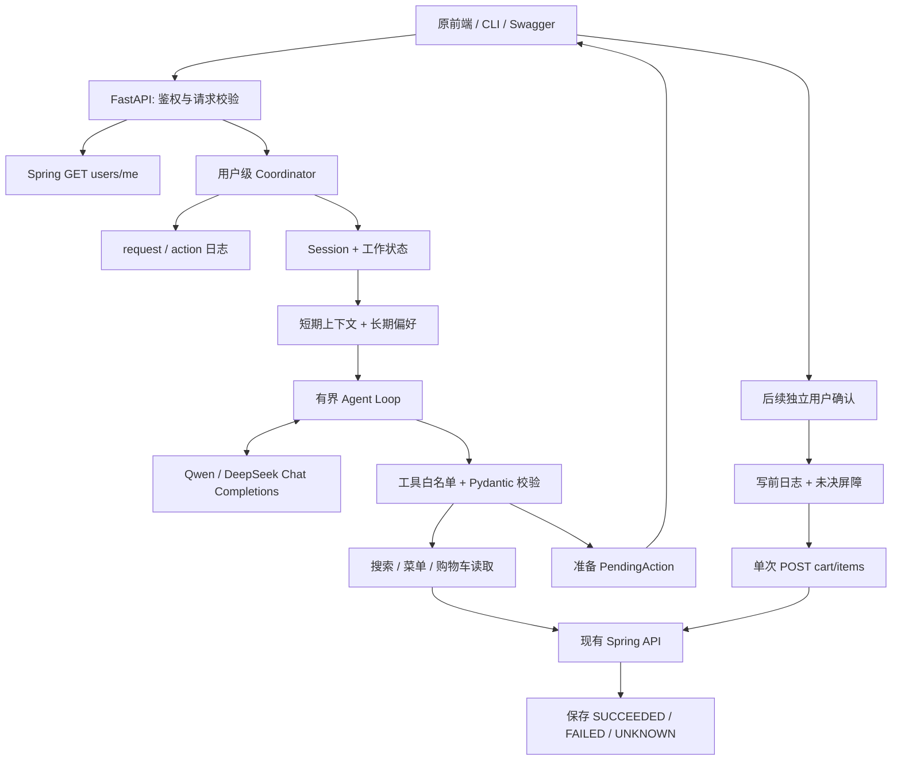
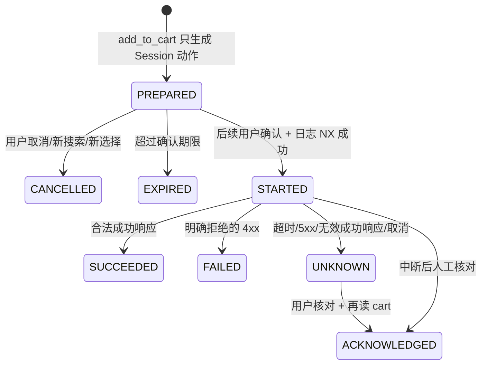

# Agent V2 架构、执行循环和可靠性

## 1. 先建立正确的责任边界

Agent 不是把一句话直接交给模型后就相信答案的接口。它是一层受控工作流：模型提出“下一步想调用什么”，应用判断这个工具是否存在、参数是否合法、引用是否来自真实菜单，以及这一步能不能现在执行。

Spring 始终是业务事实来源。Session 中的菜单和购物车是快照；长期记忆是用户偏好。它们都不能覆盖真实价格、库存和授权。



## 2. 模块与关键方法

|模块|核心方法/对象|输入与职责|
|---|---|---|
|`app/main.py`|`create_app/lifespan`|读取配置，装配模型、HTTP client、Session store、锁和记忆；关闭资源|
|`app/api/routes.py`|`require_customer`|转发 JWT 给 users/me，校验 CUSTOMER 和稳定 UUID；禁止客户端指定 user_id|
|同上|`chat/get_search_cards/get_action/acknowledge_action`|公开 HTTP 边界；JSON/UUID/权限校验|
|`app/agent/orchestrator.py`|`chat`|用户锁、请求重放、加载 Session、路由确认/取消/模型循环、保存响应|
|同上|`_run_tool_loop`|调用模型 → 校验/执行工具 → 更新结构状态 → 将工具结果交回模型|
|同上|`_build_context`|偏好、旧用户引用、结构状态、近期消息、当前消息，按预算构造上下文|
|同上|`_confirm_action`|重放 action 检查、过期检查、未决写屏障、预检、日志、单次提交和结果记录|
|`app/llm/chat_completions.py`|`ChatCompletionsModel.respond`|统一 Qwen/DeepSeek/OpenAI 的 messages/tool_calls/usage；转换 developer role|
|`app/tools/executor.py`|`execute`|白名单派发、严格参数验证、筛选合并、引用检查和响应归一|
|同上|`_prepare_add/check_add/commit_add`|分别准备、读当前快照预检、执行单次添加；commit 不暴露给模型|
|`app/clients/onlineorder_backend.py`|`OnlineOrderBackendClient`|真实 HTTP 合同、响应解析、安全错误映射；读重试/写不重试|
|`app/models/session.py`|`ConversationSession/ConversationState`|有类型的状态文档，兼容旧 Session 的缺省字段|
|`app/models/harness.py`|`PendingAction/ActionRecord/RequestRecord/TurnMetrics`|确认、幂等和可观测性的应用数据结构|
|`app/memory/coordinator.py`|两个 Coordinator|本地带引用计数的锁、Redis 跨 worker 用户锁|
|`app/memory/journal.py`|`HarnessJournal`|按稳定用户 ID 隔离的 request、action、未决屏障日志|
|`app/memory/compaction.py`|`compact_session`|保留完整近期轮次，将更旧的用户原话压缩成有界引用列表|
|`app/memory/retrieval.py`|`select_memories`|小规模确定性检索；安全约束优先，其余按词重合排序|
|`app/memory/extractor.py`|`ToolMemoryExtractor.extract`|稳定偏好信号门控、独立模型调用、schema 与原文证据验证|
|`app/evaluation`|`evaluate_suite/DemoBackend`|合成后端、多轮标签、指标计算、可复现故障注入|

`openai_responses.py` 和 `OpenAIMemoryExtractor` 保留为旧版本兼容代码，V2 的应用装配不使用它们。研究当前主链路时优先阅读 ChatCompletionsModel 和 ToolMemoryExtractor。

## 3. 一个普通对话轮的完整调用链

1. API 校验 message 非空且不超过 4000 字符，sessionId/requestId/confirmActionId 如有必须是 UUID。
2. require_customer 请求 Spring users/me；JWT 留在请求上下文，不进入 prompt、Session 或日志。
3. Coordinator 以稳定 user_id 上锁，序列化该用户所有 Session 的 Agent 请求。不同用户可并发。
4. 查询 requestId 日志。输入 fingerprint 相同且已完成则原样重放；不同输入拒绝；已中断记录不会自动重跑。
5. 读取 Session。显式传了不存在的 sessionId 则 404，防止把“第二个”错误绑定到空状态；没有传才新建。
6. 对已有 Session 校验 owner；旧 fingerprint Session 只有通过旧指纹验证后才迁移为稳定用户 ID。
7. 保存 STARTED request 记录，启动本轮 75 秒总时限。
8. 如果是用户对待确认动作的明确确认/取消，走程序分支；不让 LLM 判断是否可执行写入。
9. 否则读长期记忆（最多等待 5 秒），构造上下文，进入模型/工具循环。
10. 模型给出工具调用；executor 校验参数，client 调真实 API，成功才更新工作状态；错误形成结构化 tool result。
11. 每次工具后保存 Session checkpoint。读取结果放回模型；准备添加时直接由应用返回确定性的确认提示，不再要求模型组织“成功”措辞。
12. 普通轮结束后尝试抽取稳定偏好，失败只记降级日志，不使正常业务调用失败。
13. 追加 user/assistant 成对消息，压缩过旧引用，增加 turn_count/revision，保存 Session；缓存完整 ChatResponse；返回 traceId 和指标。

## 4. Loop 的边界及为什么顺序执行

```python
while True:
    check_context_budget()
    turn = await model.respond(context, allowed_tools)
    if no_tool_calls:
        require_nonempty_answer()
        return answer
    for tool_call in turn.tool_calls:
        check_step_budget_and_duplicate_signature()
        result = await executor.execute(tool_call)
        checkpoint_application_state(result)
        append_tool_result_for_next_model_call(result)
        if result.prepared_cart_action:
            return application_generated_confirmation_prompt
```

模型最多提出 5 个被尝试执行的工具调用；参数错误也占一次。相同名称和规范化 JSON 参数的重复调用会中断，防止重复循环。换参数纠正可以继续，但仍受全局次数与时间限制。SDK 的模型网络重试最多 1 次；它是同一逻辑模型调用的传输重试，不是重新执行业务工具。

工具顺序执行，因为同一轮可能“搜索 → 选第二个 → 准备添加”，后一步依赖前一步状态。即使 provider 返回多个 tool_calls，也依次验证、执行。先不并发可以避免读写顺序和部分成功问题；将来只能在依赖分析证明独立的只读工具之间并发。

`parallel_tool_calls`、provider strict 等不通用参数未发送给 Qwen/DeepSeek；Pydantic 是最终参数校验器。适配器保留 assistant 的 tool_calls，并用相同 call_id 回送 role=tool 消息，不会把 tool result 当普通用户消息。

空响应、截断、重复调用、次数用尽、上下文超限、provider 错误和总超时都会返回 `status=degraded`，保存已取得的状态。配置缺失返回 503；权限、过期、冲突保留对应 HTTP 错误。存储失败则拒绝继续，不能在日志没落地时执行写操作。

## 5. Session 管理与短期记忆

Session 是一份整体 JSON，包含 owner、messages、state、summary、版本和时间戳；memory store 保存序列化副本，Redis 使用带 TTL 的单文档 SET。`revision` 用于观察正常完成轮次数，不是 CAS fencing token；工具中间 checkpoint 不会都增加它。

state 的主要字段：

|字段|意义|修改规则|
|---|---|---|
|search|当前有效结构化筛选|新条件合并；显式 clear；新搜索才清空|
|last_search_results|真实菜单 ID 与显示位置映射|成功搜索/浏览替换；失败不覆盖|
|selected_item|明确选中的商品|只有选择工具修改；新结果清空|
|results_updated_at|候选快照时间|超过默认 15 分钟不得据此准备添加|
|last_restaurants|已取得的餐厅引用|模型不能用未知 restaurant_id 请求任意路径|
|pending_action|应用生成的确认对象|添加只准备；新搜索/选择撤销旧动作；默认 5 分钟过期|
|cart|最近一次工具确认的购物车快照|只有真实工具返回后修改，不能作为实时事实|
|phase|CHAT / AWAITING_CONFIRMATION|由应用控制，不由模型输出直接覆盖|

schema 保留早期设计中的 CHECKOUT_PROCESSING/DONE，但本分支没有进入它们的业务流程，也没有 checkout 工具。不要因为枚举有这些值就声称实现了结账。

默认保留 12 条近期消息，即 6 个完整 user/assistant 轮。超出的旧 user 原话每条最多 180 字符，最多保留 6 条；不把 assistant 的猜测压缩成长期事实。summary 字段因此是旧用户引用列表的 JSON 字符串，而不是另一份可执行计划。它可能丢信息，不能用来恢复商品 ID、价格或待执行动作；关键状态保存在 state。

上下文顺序：系统指令 → 检索到的长期偏好 → 旧用户引用 → 工作状态 → 近期消息 → 当前消息。整体默认 30000 字符的近似预算；必要时移除最老完整消息对。结构状态给模型最多 20 个候选和餐厅，工具输出最多 8 项，Session 仍保存完整候选（最多 100）。如果结构数据本身超预算，受控中断并保留卡片，而不截断半段 tool_call。

字符预算不是 tokenizer 精确计数；中英文 token 比例不同。它是可移植、保守的应用预算，真实上线应加入目标模型 tokenizer、输入 token 预估和超限监控。

## 6. 长期记忆：何时写、如何用、如何忘记

长期记忆由 Spring 以 `(user_id, memory_key)` 持久化，例如 `spice.preference`、`allergy.peanut`。它跨 Session，而近期消息只属于单个 Session。

读取：每轮最多取最近 50 条候选。`select_memories` 用简单英文词/中文字符重合排序，默认选 8 条，并优先保留候选集合内所有 allergy/diet/restriction 类约束。这个方法易于调试且不引入新服务，适合当前小菜单；它不是全量历史语义召回。超过 Backend 候选上限的旧记忆可能根本进不了排序，安全信息也有这个限制。

使用：当前用户明确要求 > 当前结构状态中的有效筛选 > 未指定条件时的历史偏好。模型根据记忆选择工具参数；程序仍独立合并 state。口味不是绝对约束；过敏记忆仅用来提醒，不等于后端有过敏原数据或医学安全承诺。

写入：出现“通常/一直/记住/过敏/usually/always/allergic”等保守信号才增加独立的抽取模型调用，普通“找15美元鸡肉”不会触发。这减少费用和把一次订单污染成偏好的风险，也会漏掉部分无信号表达。

抽取仅接收当前用户消息与已有 memory，不能调用购物车工具。返回 `record_memories`，每条变化必须有当前消息的原文 evidence。Pydantic 限制格式、最多 5 条、键值长度；应用检查 evidence 确实是子串、键属于偏好类别；DELETE 只处理已加载的既有 key。UPSERT/DELETE 发送给现有 Spring 接口，未支持的 evidence 字段不会发送。

证据匹配只证明引用存在，不能证明模型的语义归纳正确；例如取一小段原文仍可能误解。当前没有持久化 provenance、冲突置信度或人工 memory 管理 UI。高风险场景应该让用户确认记忆变化，并在可修改后端时增加来源、版本、撤回历史和安全约束专用存储。别在面试中把这些未来能力说成已经实现。

读取、抽取、写入都有限时，失败对本轮点单非致命。日志不包含用户文本、Key、JWT 或完整异常响应。跨 Agent worker 的用户锁避免同用户抽取写入顺序互相覆盖；其他客户端写入仍遵循 Backend 的最后写入行为。

## 7. 工具定义与参数验证

工具集合及副作用：

|工具|输入|副作用|错误后的策略|
|---|---|---|---|
|search_menu|结构筛选、start_new_search、clear_filters|只改 Session|保留原筛选；允许有界纠正|
|list_restaurants|空对象|保存餐厅引用|读失败可有界重试|
|get_menu|已知餐厅 UUID|替换候选列表|不能请求猜测的餐厅|
|select_search_result|1-based position|记录选择，不添加|不存在则明确报错|
|get_cart|空对象|保存购物车快照|始终请求后端，不靠旧消息回答|
|add_to_cart|position 或 null、quantity|仅准备待确认动作|不暴露 ID/price/userId/confirmed 参数|

`strict=True` 拒绝 quantity="2"、true、1.5 等类型混淆；extra=forbid 拒绝多传的 confirmed、user_id、menu_item_id。数量限制 1..99，position 1..100。只有真实候选映射出的 UUID 能形成 action。搜索同时验证合并后的 min_price <= max_price，不只验证单次增量。

参数错误反馈只包含安全错误说明，不把 Pydantic 原始 input 或后端响应原文回传到模型。工具结果 schema 的 `ok` 和 error.code 是应用判定成功的依据。

## 8. 两层幂等与 UNKNOWN 状态

### 请求去重

`request:{user}:{requestId}` 保存 fingerprint、生成的 sessionId、STARTED/COMPLETED/FAILED 和完整响应。相同输入重放同一响应，避免重建对话或重复模型调用。默认保留 7 天，所以历史请求回执可能比 Session 活得久；回执不是新的实时读取，不能恢复过期 Session。

### 操作去重

`action:{user}:{actionId}` 与 requestId 独立。不同 HTTP 请求只要确认同一 action，都不会再次提交同一个增量。状态机：



PREPARED/CANCELLED/EXPIRED 是流程概念，其中只有当前待确认动作存于 Session；执行后的 action 日志使用 STARTED/SUCCEEDED/FAILED/UNKNOWN/ACKNOWLEDGED 枚举。

真正发送之前的顺序：读 cart/menu 预检 → NX 创建 STARTED action → 保存用户未决屏障 → 清空 pending 并 checkpoint Session → 单次 POST → 保存结果 → 若明确成功/失败则解除屏障。

|崩溃位置|可能发生的业务事实|恢复行为|
|---|---|---|
|准备后、用户未确认|没有发送|待确认可取消或过期|
|STARTED 后、POST 前|可能根本没发送|也保守禁止重发该 action，人工检查|
|POST 发送后、响应前|可能提交，也可能未提交|UNKNOWN，屏障阻止后续 Agent 写入|
|成功响应后、结果日志前|后端可能已累加|STARTED/屏障仍在，不会重复发送|
|结果日志后、Session/HTTP 响应前|日志有成功回执|再次确认读回执；不再次 POST|
|Session 过期但 action 日志尚在|动作历史仍在|用户可按 actionId 查询核对|

这是牺牲部分可用性来获得保守的单 action 至多一次派发。**不能称为端到端 exactly-once**：两个存储没有分布式事务，网络超时不能证明未提交，日志会过期或丢失，原 UI 也能独立修改 cart。acknowledge 不推断因果，只记录用户允许继续。

## 9. 重试矩阵与并发限制

|请求|网络异常|429 / 5xx|400 / 401 / 403 / 404 / 409|
|---|---|---|---|
|读 API / 只读 POST search|最多 1 次指数退避+小抖动|最多 1 次；不无限等待 Retry-After|不重试|
|memory UPSERT/DELETE|同上|同上|不重试|
|POST cart/items|不重试，UNKNOWN|429 明确失败；5xx UNKNOWN|明确失败，不重试|
|LLM Chat Completions|SDK 有界重试，受总时限限制|同左|由 SDK 处理并向外提供安全错误|

内存 Coordinator 只保护单进程，引用计数在最后一个等待者退出时回收锁，避免锁表长期增长。Redis Coordinator 使用用户级分布式锁，等待最多 2 秒，租约为总轮次时限+30秒。生产校验要求 Redis；不同用户不用同一把全局锁。

租约是有时限互斥，不是跨系统 fencing。长时间 event-loop 停顿、Redis failover、TTL 到期或日志被驱逐都可能弱化保证。NX action 记录是同一 action 的额外防线，但 Redis 丢数据后不能保证。实际生产需要验证 Redis 持久化/复制策略；更强保证应在未来允许修改 Spring 时把 idempotency key 与购物车修改放入同一数据库事务。

为了当前可审查的规模，本实现按用户串行化整轮，包含模型等待。吞吐上限受单用户串行和模型调用耗时影响。以后可以分离会话只读锁与购物车操作锁，但必须同时解决跨 Session 偏好顺序和写屏障，不能简单把锁删掉。

## 10. 可观测性与后续演进

每轮返回 traceId、总耗时、逻辑模型调用数、模型耗时、主循环 input/output tokens、逐工具耗时与安全错误码。确认分支不消耗 LLM。日志只记录这些结构指标，不记录 prompt、tool 参数或 JWT。HTTP 鉴权、锁等待和最终 request 回执写入不在当前 duration_ms 计时内；外部压测需另测 HTTP 全链路。

当前 token 指标只覆盖主循环，独立 memory 抽取的模型费用尚不汇总；真实成本应从 provider usage/billing 补充。没有凭空给出 QPS、线上 p95 或生产 task-completion 的数字。具体测法见评测文档。

优先后续工作：真实模型独立测试集、接真实 Spring 的隔离集成测试、UI 刷新/结构化确认按钮、记忆 provenance 和冲突管理、完整 tracing 与费用归因、后端原生购物车幂等。checkout 必须另做订单草稿、确认、支付和恢复状态机，不能直接加入普通工具列表。
